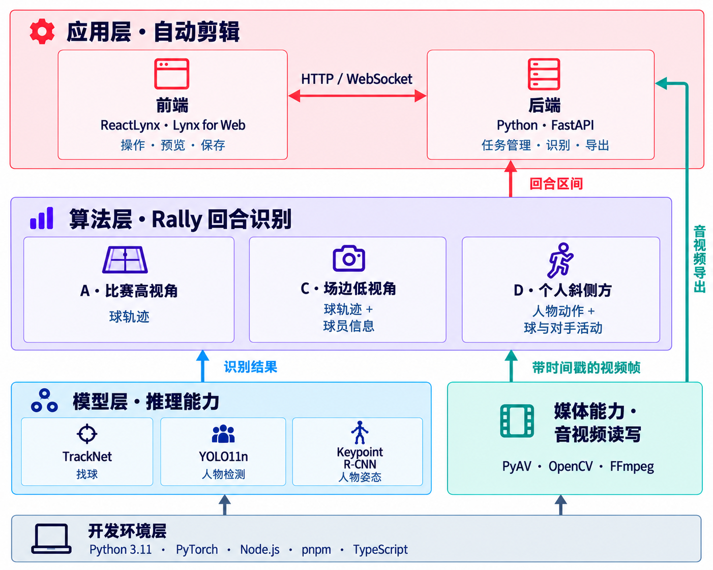
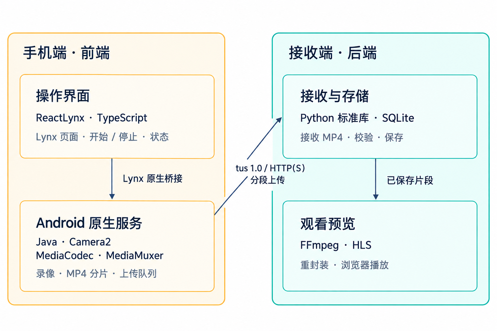

# Smash Suite

Smash Suite 是一个本地优先的羽毛球视频处理套件。
当前支持了一个自动剪辑产品，用于去除视频中的非对抗垃圾时间。

## 快速上手

- **开发项目**：
  - 参考 [开发环境](#开发环境) 准备环境，再进入需要开发的模块或产品目录阅读详细流程。
- **使用产品**：
  - [自动剪辑](apps/video-clipper/README.md)
  - [Android 场边采集](apps/android-capture/README.md)

## 当前状况与演进目标

项目提供了一些独立模块，可以提供单点的模型能力或是算法能力。
利用这些开源或自研模块可以连接和组合成各类产品，例如 [自动剪辑](apps/video-clipper/README.md)。

项目会持续优化和新增算法模块并希望提供更多的集成化产品。

## 架构与技术栈



箭头表示能力的组合与数据传递。

基础模块可以独立调用和测试，不依赖应用的网页接口或会话类型。媒体模块负责视频信息、帧输入和音视频导出，模型模块负责推理和权重，回合模块组合这些能力输出区间；应用负责将用户请求转换为模块参数，并管理任务、预览和保存。算法效果与产品流程分别验证，具体接口和行为在各目录 README 中维护。[二维球路与成片叠图首版](docs/features/trajectory-overlay/README.md)已按用户确认合入 develop，并继续演进：当前支持 A（比赛高视角）场景，高远球估计仍不准确，其他拍摄场景待扩展。

### Android 场边采集

独立的 Android 应用与接收端，尚未接入自动剪辑。



## 项目结构

```text
.
├── modules/              # 可独立调用和测试的基础能力
│   ├── media/            # 视频读取、帧流、音视频输出
│   ├── models/           # 模型推理、配置和权重
│   ├── rally/            # 回合识别、场景方案、评估和实验
│   └── trajectory/       # 自动球场标定、逐拍平面球路与实验
├── apps/                 # 组合基础能力的产品
│   ├── video-clipper/    # 自动剪辑网页与本机后端
│   └── android-capture/  # Android 采集应用与接收端
├── datasets/             # 样本录像、人工标注和素材清单
├── tools/                # 独立工具
├── docs/                 # 项目说明、计划和实验报告
└── backup/               # 历史代码与材料
```

## 开发环境

主项目的模型、算法和应用后端共用开发环境，需要 Python 3.9+（建议使用 3.11）、pip 21.3+、Node.js 20.19+ 和 pnpm 9+。在仓库根目录执行：

```sh
python3 -m venv .venv
.venv/bin/python -m pip install 'pip>=21.3'
.venv/bin/python -m pip install -e '.[dev]'
pnpm install --frozen-lockfile
```

以下工具另有环境要求：

| 工具 | 环境 |
| --- | --- |
| 训练素材采集工具（`curate-badminton-training-data`） | Python 3.10+，由工具管理独立虚拟环境；其中的 yt-dlp 不支持 Python 3.9，详见[素材采集环境](datasets/README.md#素材采集环境) |
| Android 原生应用构建 | JDK 与 Android SDK，详见[Android 场边采集](apps/android-capture/README.md#构建与安装) |

## 查看项目文档

各目录的 README 和项目文档可以在本地文档站中连续阅读。在仓库根目录执行：

```sh
pnpm install --frozen-lockfile
pnpm run docs:dev
```

浏览器会自动打开文档站，默认地址为 `http://127.0.0.1:5173/`；端口占用时以终端显示的网址为准。通过侧栏查看模块、产品、路线图和实验报告，也可以搜索内容。修改文档后页面自动刷新，按 `Ctrl-C` 停止服务。

构建、预览和导航配置见[文档站工具](tools/docs-site/README.md)。直接阅读 Markdown 可从[文档目录](docs/README.md)开始。
