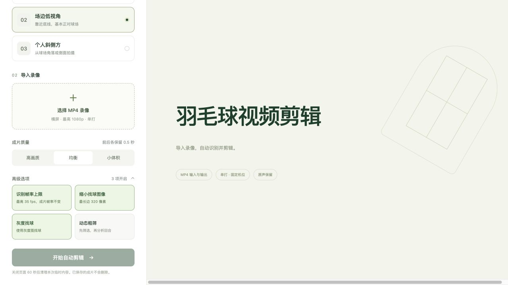

# 高级配置验证

## 当前结论

高级配置已接入产品，界面为两列高亮按钮，默认值和保存规则见[产品需求](../../requirements.md#高级选项)。界面复核、前端类型检查与构建、247 项后端检查及 5 项前端配置检查均通过。八组真实短片均已完成识别和成片；新增的轨迹显示联用检查另行记录。

## 验证范围

使用现有三类短片，分别运行全关闭与产品新默认配置，并补充场边和个人视角开启动态粗筛的两次运行。默认配置的三次请求故意不传 `optimizations`，验证未配置时产品直接采用场景默认值。

每次经真实产品 HTTP 接口上传、识别与生成 balanced 成片，核对请求、任务状态和结果中的配置，检查有效识别参数、原始及导出区间、固定前后 500ms 补时和成片解码。每个输入配置仅运行一次；耗时与输出差异分别记录，不据此声称稳定提速或人工准确率。

## 输出与单次耗时

表内为完整产品耗时／原始回合段数。A 默认已开启粗筛，因此不重复运行同一配置。

| 场景 | 四项全关闭 | 产品默认 | 四项全开启 |
| --- | --- | --- | --- |
| 比赛高视角 | 47.87 秒／5 段 | 29.77 秒／5 段 | 与默认相同 |
| 场边低视角 | 133.22 秒／9 段 | 116.36 秒／8 段 | 106.97 秒／8 段 |
| 个人斜侧方 | 289.76 秒／13 段 | 289.69 秒／13 段 | 146.51 秒／7 段 |

三类全关闭输出与同输入的[已有冻结基线](../performance-validation-20261023/matrix.json)逐值一致，包括原始识别区间和 500ms 补时后的导出区间。输入 SHA 与双方结果 SHA 保存在机器摘要中；旧基线耗时不作为本轮同期控制。

默认配置会改变回合边界；C 默认段数也发生变化。D 主动开启粗筛后段数从 13 变为 7，当前产品仍按用户确认默认关闭 D 粗筛。逐段差异供人工复核，不能仅凭段数或节省耗时判断内容是否正确。

八组比较未加入球路叠图；运行期间并行合入了轨迹显示功能，其与 A 默认配置的联用另做一次真实产品检查，不混入上表耗时。

额外的 A 默认配置与球路叠图联用已通过：四项配置均为开启，识别区间和导出区间与无叠图的 A 默认结果逐值相同，球路观测、逐拍轨迹和叠图文件均已生成，成片完整解码通过。此次总耗时 75.31 秒，单独用于整合功能验收。

## 界面复核

已检查默认收起、开启数量、按钮高亮与取消、场景切换、显式关闭后的刷新恢复、新标签页默认值，以及展开收起不改变配置。

统一结果查看器已确认视频可播放、A/C/D 可切换，点击时间轴后三行与视频同步。A 的 3.796 秒位置显示全关保留、产品默认删除，与保存的起点 3.640／3.960 秒一致；该局部查看不代表人工准确率验收。

## 证据入口

- [真实产品结果](results-native.json)：逐例状态、原始输入与代码版本、阶段计时和证据目录。
- [机器验证摘要](validation.json)：配置和媒体解码断言、逐段差异、冻结基线对照和球路联用记录。
- [轨迹显示联用](show-paths-results.json)：独立 A 场景真实产品运行；[区间复核截图](review.jpg)保留局部对齐位置。
- 自动检查覆盖三场景全部 16 种开关组合、C 双组与尾帧、动态扩展复用，以及 D 两遍选帧、姿态跳过和肩腕上下文。
- [复跑说明](../../../../docs/ai/advanced-options/preparation.md)：现有输入、模型缓存和运行命令；输出保存在应用 `.runtime/advanced-options/20261023-native/`。

旧测试包未重新打包；真实高帧率识别效果仍缺素材，本轮使用合成帧验证 35fps 选择及时间对齐。
