# 性能基线与优化诊断

## 先看结论

本轮在 macOS Apple 芯片环境，沿用当前 A 高位、C 场边、D 个人机位算法、balanced 成片质量及自动设备选择，完成六份固定输入各一次真实识别和成片。A、C 的完整处理快于录像播放，D 慢于播放。优先验证 D 的 CPU 姿态入口与 A/C/D 共用的图像前处理和模型调用；C 关联及 D 第二遍解码的孤立收益上限较小，不宜先整段改写语言。

六次正式测量开启聚合统计；三份短片另做关闭统计的 Python 剖析，A 再补一次原生采样，共 **10 次完整产品处理**。十份成片均完成结构、实际解码和区间时长检查；三类统计 ON/OFF 对照及 A 原生补录对照的原始区间和成片结构均严格相等。本任务已通过独立验收，任务分支状态为**已完成，待人工确认**；尚未集成到 develop。不代表已完成浏览器交互、重新打包、30 分钟产品验收或准确率验收。

### 六份正式结果

单位为秒。录像列分别是容器时长与产品使用的视频流时长；处理速度为视频流时长除以完整总耗时，越大越快。小数展示有舍入，精确值见 [JSON](performance-baseline/six-formal-summary.json) / [CSV](performance-baseline/six-formal-summary.csv)。

| 输入 | 录像：容器 / 视频流 | 准备 | 识别 | 成片 | 总耗时 | 处理速度 | 成片段数 |
| --- | ---: | ---: | ---: | ---: | ---: | ---: | ---: | ---: |
| A-short | 168.091 / 168.000 | 0.46 | 38.88 | 8.71 | 48.05 | 3.50× | 5 |
| A-long | 900.211 / 900.120 | 0.48 | 202.20 | 45.10 | 247.77 | 3.63× | 21 |
| C-short | 180.000 / 180.000 | 0.50 | 118.25 | 18.42 | 137.17 | 1.31× | 9 |
| C-long | 905.144 / 905.036 | 0.47 | 523.37 | 61.98 | 585.81 | 1.54× | 30 |
| D-short | 250.900 / 250.900 | 0.49 | 321.12 | 13.48 | 335.08 | 0.75× | 13 |
| D-long | 611.112 / 611.112 | 0.58 | 834.24 | 49.33 | 884.16 | 0.69× | 31 |

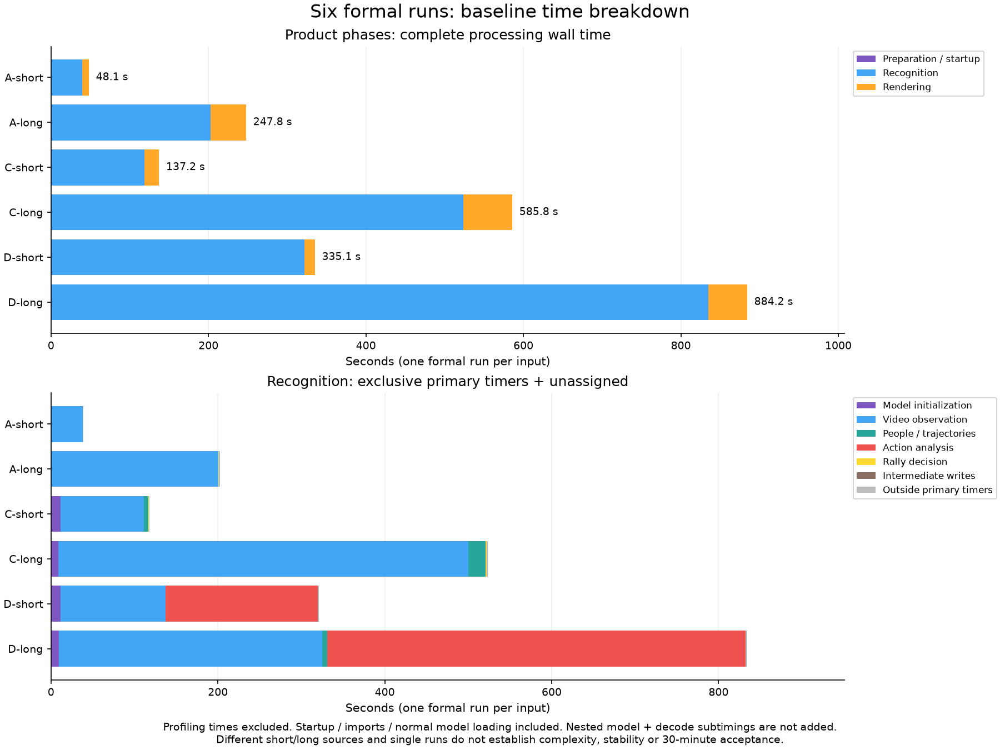

### 输出检查说明

[检查摘要](performance-baseline/output-validation.json)保留实际结果及原始文件 SHA。十份输出均有视频、期望音轨、有效尺寸与实际解码帧；每份 worker 声明的 `output_duration_ms` 与导出区间求和之差为 0（只按浮点精度核对）。实际媒体容器时长、视频流时长和首帧 PTS 分列保留在检查摘要：例如 A 短容器 46.44 秒、视频流 duration 46.42 秒、首视频 PTS 0.02 秒、末 PTS 46.42 秒；A 长同样有 20ms 首帧偏移。导出保留实际帧间隔与共同音画起点，因此声明时长相等不表示所有媒体时长口径相等。三份正式短片统计开启、剖析关闭，`predictions`、`export_ranges` 与编码/尺寸/音轨/解码帧结构相等；A 原生补录与正式短片亦相等。没有要求编码文件字节相等。

旧 16 例依赖的 35 份缓存已缺失，用户批准用上述真实 ON/OFF 对照替代，不称旧检查通过。当前 C 短 9 段、D 短 13 段与历史 8/14 段不同；已核实媒体 SHA 等不同，具体因果未证明，因此不继承历史效果数字。[调查与执行记录](../../../docs/ai/performance-baseline/controller/state.md)保留差异。本轮不新增历史效果恢复验收。

## 从瓶颈选择下一步

下表是互斥的识别主阶段，单位秒。公共校验及未分摊间隔单列，主阶段无需强行凑满产品识别耗时。模型初始化发生在识别阶段，不能只看不足一秒的产品“准备”。

| 输入 | 模型初始化 | 视频观测 | 人物与轨迹 | 动作分析 | 回合判断 | 中间写盘 | 未分摊 |
| --- | ---: | ---: | ---: | ---: | ---: | ---: | ---: |
| A-short | 0.10 | 37.82 | 0.00 | 0.00 | 0.11 | 0.00 | 0.85 |
| A-long | 0.08 | 200.58 | 0.00 | 0.00 | 0.68 | 0.00 | 0.86 |
| C-short | 11.65 | 99.33 | 5.39 | 0.00 | 0.66 | 0.00 | 1.23 |
| C-long | 8.78 | 491.40 | 20.83 | 0.00 | 1.38 | 0.00 | 0.98 |
| D-short | 11.28 | 125.75 | 0.45 | 181.99 | 0.00 | 0.00 | 1.66 |
| D-long | 9.24 | 315.85 | 5.62 | 501.90 | 0.00 | 0.01 | 1.62 |

以下“上限”是把指定工作完全消除、其他工作不变的理想节省时间，不能当作预计收益。嵌套项目、并行解码和不同建议之间不能相加。每项改动都应重新比较相同视频、模型、配置的区间与成片，再复测完整产品时间和资源。

### 优先：D 的逐人姿态入口

D 短/长动作分析占总耗时 54.31% / 56.77%；其中姿态入口为 162.02 / 441.10 秒，占 48.35% / 49.89%。对应 2432 / 5837 次裁剪和姿态调用。入口包含图像转张量、模型 forward 和返回处理，不能称为纯模型内核或纯 Python。当前 Keypoint R-CNN 走 CPU，TrackNet 则走 MPS。

先拆分入口内前处理、forward 与返回的独立耗时，验证裁剪复用、批处理或不同设备是否减少开销；这几项尚未实施，设备支持、内存与效果均待验证。理想消除整个入口的上限为 162.02 / 441.10 秒，实际只能取得其中一部分。不能把此上限再加到动作分析上。

### 优先：图像前处理与推理/传输边界

A 短/长 TrackNet 前处理为 9.28 / 52.66 秒，占总耗时 19.31% / 21.25%；推理及传输为 26.46 / 143.54 秒，占 55.07% / 57.93%。C 为 18.06 / 90.68 秒前处理及 65.40 / 335.15 秒推理及传输；D 为 12.82 / 30.92 秒及 51.42 / 128.63 秒。当前统计不能拆开 MPS 运算与拷贝/回传等待。

Python 路径指向 resize/interpolate、TrackNet 调用，A 原生 CPU 栈亦显示 PyTorch 抗锯齿缩放、copy、除法等内核。先核实张量布局、缩放位置、连续性与跨设备往返，减少重复转换，再评估批处理。改变缩放实现或设备可能改变模型输入与区间，必须保留像素/数值和最终效果对照。孤立前处理完全消除才可节省上述前处理时间；推理/传输整个桶是其自身的理想上限，不能据此声称拷贝占满该桶。

### 次优先：D 第二遍解码与转换

D 每份录像完整解码两遍：短片每遍 7527 帧，长片每遍 18325 帧。姿态遍解码与 BGR 转换分别为 7.61 + 6.42 / 30.41 + 15.82 秒。即使全部消除也仅节省 14.04 / 46.23 秒（总耗时 4.19% / 5.23%）；它们已在动作分析内，不能另加。

可验证在观测时保存必要裁剪或复用解码结果，但会增加内存、存储或写盘。先比较裁剪复用所需字节、处理峰值和区间相等性，不能为避免一遍解码而无界保留整片图像。

### 次优先：C 候选与轨迹关联

C 短/长有 69821 / 254385 个候选峰、184 / 798 条轨迹和 226 / 911 个飞行段。人物与轨迹互斥主阶段为 5.39 / 20.83 秒，占总耗时 3.93% / 3.56%；这里还包含人物轨迹处理，整个阶段全部消除才达到这一上限。

Python 识别子树能定位 `associate`、候选生成和 `seeded_source.predict`，并不证明它们全由解释器计算；NumPy/SciPy 已有原生工作。先对候选数与匹配次数做分布检查，验证等价的数据结构或少量循环改写。未有证据支持整段 C++/Rust 重写获得主要收益。

### 模型初始化与成片

C 模型初始化 11.65 / 8.78 秒，D 11.28 / 9.24 秒；A 为 0.095 / 0.076 秒。每次均是新 worker，复用已准备权重，包含正常校验和加载。长短来源和缓存状态不能证明稳定差异。可验证长期进程内安全复用，孤立上限就是这些初始化秒数，但需重新评估隔离、取消和内存回收；本轮未实现常驻模型。

成片 A 为 8.71 / 45.10 秒（总耗时 18.13% / 18.20%），C 18.42 / 61.98 秒（13.43% / 10.58%），D 13.48 / 49.33 秒（4.02% / 5.58%）。复用当前 FFmpeg 编码路径。调整编码器、质量或并行度前须比较画面、音轨、区间边界、尺寸与输出大小；完全消除成片才达到该阶段上限，实际编码不可省略。

C/D 中间证据写盘分别不足 0.004 / 0.010 秒，不支持优先优化这部分。目录增长和空闲磁盘变化无法给出应用读写吞吐；需另外隔离读写测量，不能把整段成片归因于磁盘。

## 看资源是否限制部署

RSS 是后端、工作进程和实际采到的后代进程驻留内存之和，可能重复共享页。100% CPU 表示一个逻辑核心，超过 100% 表示多核。MPS allocated/driver 是不同的工作进程计数，不与彼此或 RSS 相加。MiB/GiB 使用 1024 进制；下表均是每秒采样的观测峰值。

| 输入 | RSS GiB | CPU 峰值 | MPS allocated / driver MiB | 外部 / MPS 最大间隔秒 |
| --- | ---: | ---: | ---: | ---: |
| A-short | 1.265 | 546.6% | 210.3 / 1108.5 | 1.019 / 1.021 |
| A-long | 1.282 | 707.0% | 291.3 / 1111.8 | 1.023 / 1.023 |
| C-short | 2.254 | 507.9% | 304.2 / 1140.6 | 1.026 / 1.348 |
| C-long | 2.460 | 676.4% | 304.2 / 1141.1 | 1.029 / 2.489 |
| D-short | 2.225 | 486.9% | 232.2 / 1138.4 | 1.025 / 1.265 |
| D-long | 2.475 | 566.4% | 252.2 / 1140.9 | 1.027 / 1.024 |

六份 RSS 观测最高点均在成片阶段，识别期仍有模型、缓存和整片观测数据。工作目录扣除源文件峰值约 16.4 / 88.9 / 43.3 / 159.4 / 20.7 / 106.4 MiB，不含持久模型缓存。目录字节是逻辑大小，卷空闲量会受其他系统活动影响。

当前不足以证明内存泄漏或给出最低机器内存：短长片来源不同，RSS 包含多进程共享，MPS 只覆盖识别。下一步应使用同一来源递增长度，比较识别前后和清理后持有量，定位候选/轨迹/观测容器的生命周期；任何释放或流式改造均需检查区间、随机访问需求和效果。

### 六份资源曲线

每张图按产品时钟对齐准备、识别和成片，展示 CPU、RSS、MPS、目录与磁盘。准备不足一秒且无落点时保留空值，不假造零。外部采样最大间隔均小于 1.03 秒、无读取错误；C 长 MPS 有四处大于 1.5 秒的缺口，最长 2.489 秒，图中断线并标灰，不能用插值掩盖。MPS 曲线不延伸到成片。

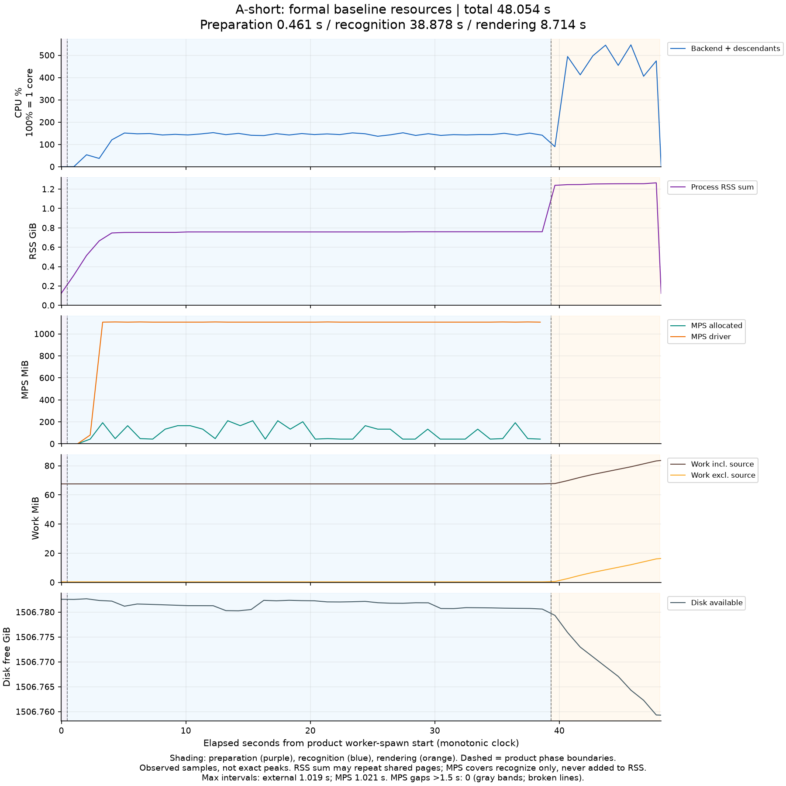
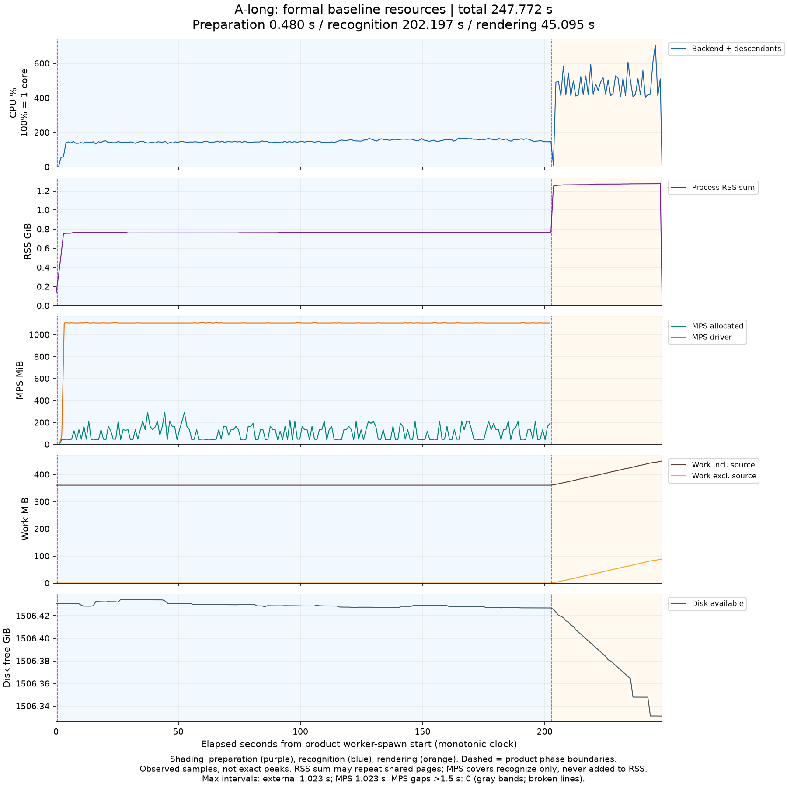
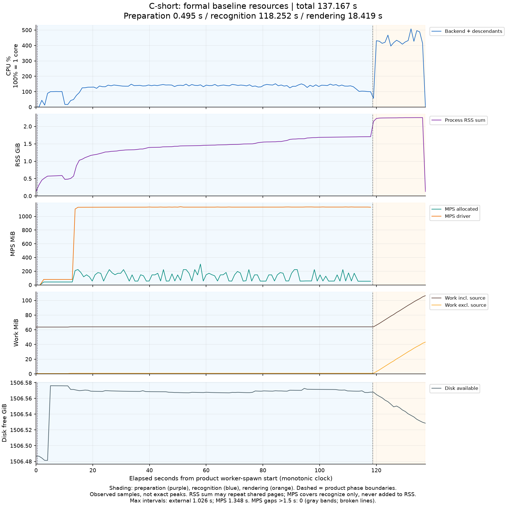
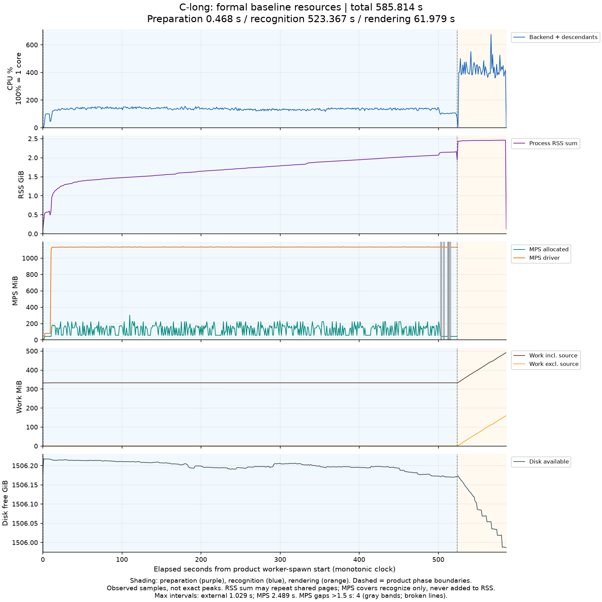
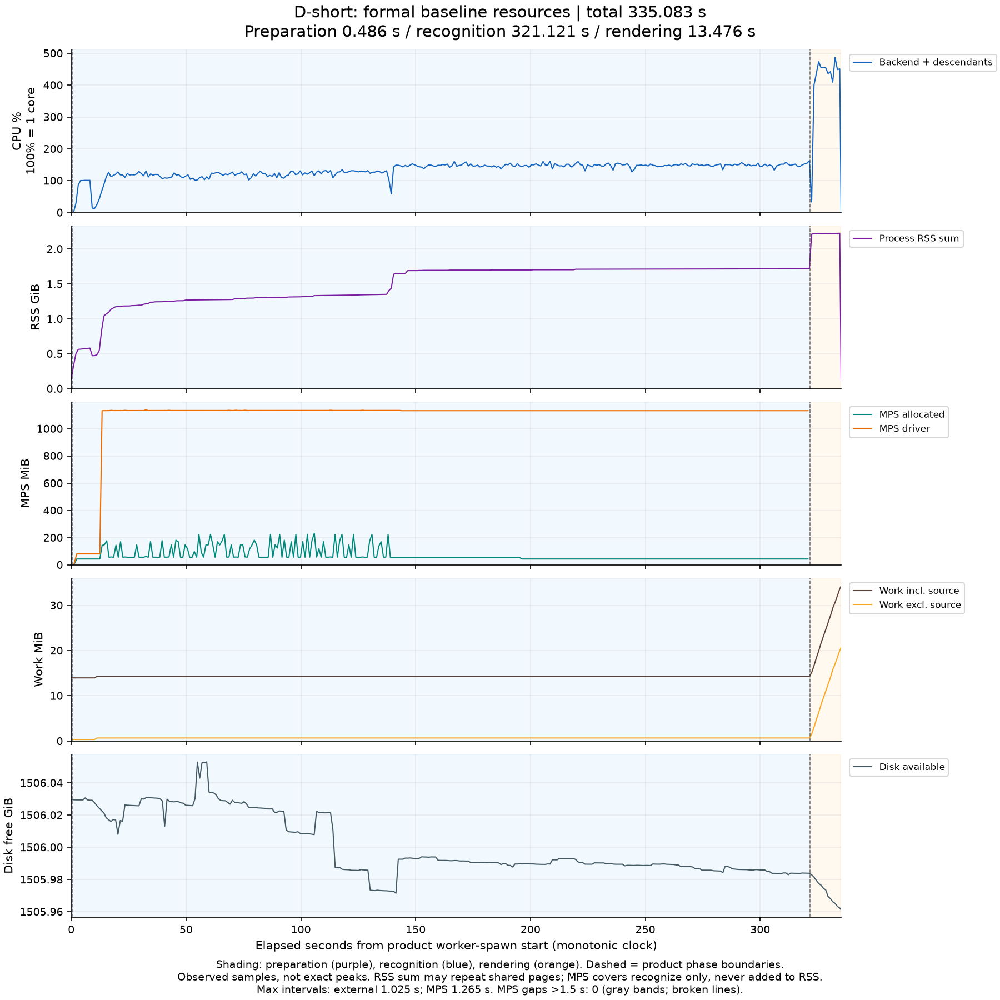
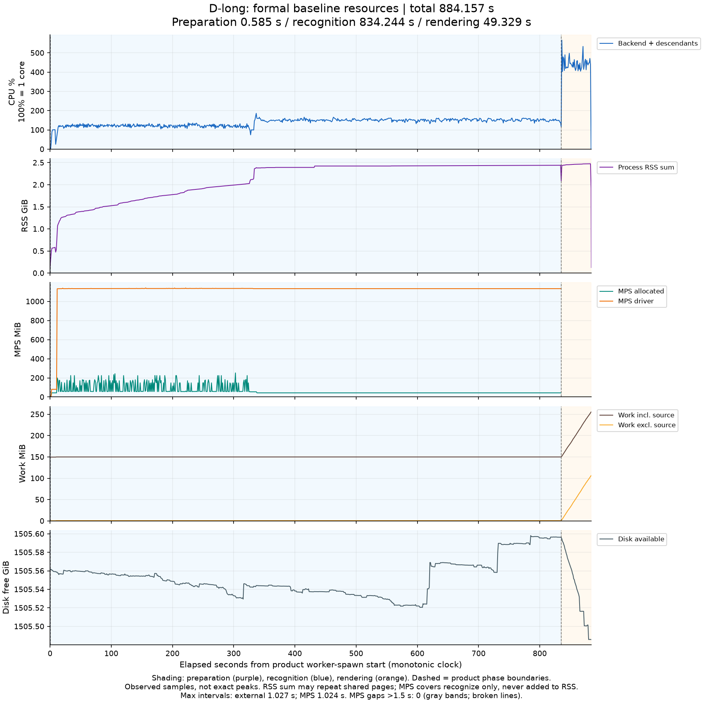

## 用采样定位，而不把栈比例当时间

### Python 独立采样

采样器在 worker 入口导入完成、正常权重处理开始前附加，覆盖此后的等待、完整识别和成片；此前导入不在 Python 栈样本内，正式总耗时仍完整保留这些导入。

[精简摘要](performance-baseline/python-summary.json)记录原始 SHA、可见识别入口区间并集及具体函数的 inclusive 和可见残余样本。py-spy 0.4.2 使用的 Inferno 图会省略宽度小于总样本 0.1% 的帧，因此 SVG 不能恢复被省略的窄帧、精确 self 样本或完整栈覆盖。识别分母只表示 SVG 中可见 recognize 入口区间的并集；inclusive 只覆盖 SVG 可见的函数出现。对单个可见节点，以可见父区间减去可见直接子区间得到的残余，是该节点自身栈驻留的上界；按函数聚合会遗漏该函数被省略的窄出现，不能称为完整函数上界。inclusive 与残余都表示栈驻留，可能包含原生库调用和等待，不是纯解释器 CPU 时间。以下使用 SVG 实际接收样本，不用采样数除以 100Hz 推墙钟。

| 场景 | SVG 接收 / 日志 collected | 展开错误 | 可见 recognize 入口并集 | 可见残余 | 覆盖状态 |
| --- | ---: | ---: | ---: | ---: | --- |
| A | 17508 / 17532 | 0 | 4210 | 1 | passed |
| C | 22631 / 22667 | 2 | 12179 | 75 | passed_with_sampling_errors |
| D | 46137 / 46153 | 0 | 32199 | 136 | passed |

C 的两次 `get_stack_trace` 展开失败、以及一条无效格式行警告已保留，底层原因未证实；属于局部缺失，不能称全程无缺失，也不由样本差额推失败时长。其可见识别覆盖已解析，并与原生窗口互证；独立验收确认足以支持下文的限定结论，缺样限制仍保留。

A 握手睡眠在 `worker.py` 等待循环有 10427 样本，和 4210 个识别样本无重叠，不是算法热点。D 全捕获还出现 Ultralytics 后台网络线程，不能把整份采样比例归入识别。可见 recognize 入口区间并集内，A 的 TrackNet 有 4177 个 inclusive 样本、interpolate 聚合可见残余 2115（不代表完整函数上界）；C observe 11540、TrackNet 9261、associate 462；D person_signals 17982、姿态入口 16058。父子值不可相加，也不能替换正式墙钟。

查看可缩放 SVG：[A](performance-baseline/python-A.svg) · [C](performance-baseline/python-C.svg) · [D](performance-baseline/python-D.svg)。

### 原生 CPU、Metal 与 MPS

A 的 Python 采样目标 PID 为 38406，原生为额外补录的 PID 42952，两次都是 UID 501；不能把两者当成同一次逐时刻对齐。A 完整 trace 的 TOC 时长 49.104748 秒，其中产品识别映射为 trace 相对 1.504132–39.659329 秒。这里只分析识别交集，不把等待、成片或保存时间计入算法热点。

A 目标 PID 在识别范围有 56257 条 CPU 样本、合计 56.257 秒采样权重（跨线程相加，不是墙钟）。独占叶节点按库汇总，PyTorch CPU 27.527 秒、libavcodec 9.286 秒、libswscale 5.534 秒、Python 可执行文件 1.449 秒。抗锯齿缩放内核两项合计 18.727 秒、copy 4.279 秒、除法 3.610 秒；符号不完整的地址保留，不猜测其归属。原生等待、调度和内核调用也可能驻留，不能把库权重直接称为纯计算收益。

A 识别交集有 93928 条目标 Metal Active 区间，合并覆盖 21.873284 秒；PyTorch MPS signpost 170595 条。下图展示分箱后目标区间并集覆盖比例，表示此进程区间占据时间，不是整机 GPU 利用率，也不能外推到六正式录像。

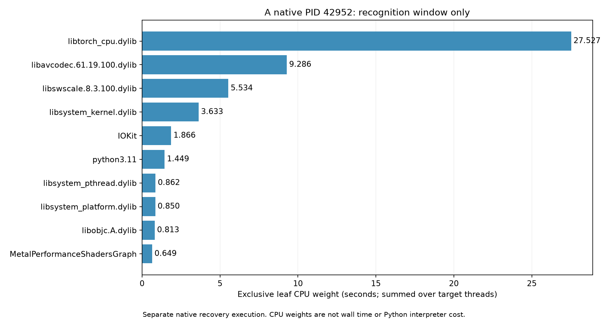
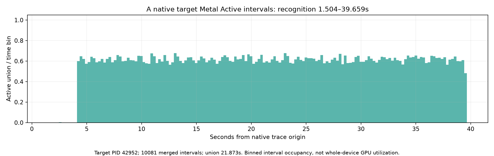

[A 精简原生摘要](performance-baseline/native-A.json) · [A 大证据 SHA 索引](performance-baseline/native-A-artifacts.json) · [A 原始 trace](../.runtime/performance-baseline/profile-control-A/native.trace)。在 Instruments 中打开原始 trace 可继续查看 CPU 栈与 GPU/MPS 时间线。A 补录与保存恢复说明见[执行记录](../../../docs/ai/performance-baseline/controller/state.md)，本轮总执行数已包含这次额外处理。

C/D 原生录制各请求 8 秒，实际总跨度和主分析窗如下。主窗统一取记录的 ready 至 TOC（trace 运行摘要）结束，再与产品识别相交；ready 是 0.1 秒轮询观察值，不按热点挑选区间。TOC 包含就绪前工具附加，不能把 C 的 13.0456 秒写成 8 秒。以下 CPU 是目标进程跨线程累计采样权重；Metal 是目标 Active 区间并集；MPS 是标记窗口驻留，三者不能相加或比较大小推利用率。

| 场景与阶段 | 目标 PID / UID | 请求 / TOC 总跨度秒 | 主窗：trace 相对秒 | 主窗跨度秒 | CPU 样本 / 权重秒 | Metal Active 并集秒 | MPS 事件 / 配对裁剪并集秒 | 状态 |
| --- | --- | --- | --- | ---: | --- | ---: | --- | --- |
| C 找球 | 50312 / 501 | 8 / 13.045600 | 5.095073–13.045600 | 7.950527 | 10411 / 10.411 | 4.634414 | 65855 / 5.652257 | passed_with_signpost_tail |
| D 找球 | 51087 / 501 | 8 / 9.189937 | 1.245430–9.189937 | 7.944507 | 9559 / 9.559 | 2.661880 | 49367 / 3.538855 | passed_with_signpost_tail |
| D 姿态 | 51087 / 501 | 8 / 8.956340 | 1.043334–8.956340 | 7.913006 | 10245 / 10.245 | 0 | 0 / 0 | passed |

三个主窗均匹配真实产品阶段，CPU/GPU 完整原始时间范围严格在 TOC 内，引用解析与重复定义诊断为零。**两份找球窗口的 signpost 完整导出尾部超出 TOC：C 0.559535 秒、D 0.549400 秒。**尾部包含 Begin、Event、End 和 MPSGraph，不能解释为“只有 End 异步完成”。独立 CNN 工具探针也复现 0.568773 秒尾部，说明表覆盖可超出运行摘要；内部缓冲或停止机制未证实。主统计排除尾部，原始事件、SHA 与诊断保留，没有调整时钟 offset 或扩大容差。这里采用带覆盖限制的有效证据；独立验收已复算原始表和探针，确认足以支持下文的限定结论，不能称无异常全覆盖。[工具边界核查](../.runtime/performance-baseline/cnn-window-probe/stop-boundary-check.json)保留独立探针数据；5.1MB 逐事件清单只由精简索引指向 `.runtime`，未复制到报告。

C 找球主窗的 PyTorch CPU 叶库权重 5.538 秒，含抗锯齿缩放等内核，支持继续拆分前处理与推理/传输，而不把 Python interpolate 的驻留视作解释器运算。D 找球 PyTorch CPU 3.297 秒、OpenCV 2.776 秒，原生叶符号出现 Farneback 光流；Python `people_flush` 聚合可见残余为 4914 个样本；它可能遗漏被 Inferno 省略的窄出现，不能称为完整函数上界，也不能全归为解释器 CPU 计算。D 姿态主窗 libBLAS 3.283 秒、PyTorch CPU 2.800 秒、torchvision 0.838 秒，并有卷积展开与 ROI Align 等叶符号，与 Python 姿态入口和源码 CPU 路径互证。这个姿态窗口目标 Metal Active 与 PyTorch MPS 标记均为零；MPS driver 缓存仍可驻留，不能用其内存平线证明 GPU 运算。

这些是约八秒阶段窗口，不证明整个 C/D 识别或正式长片的热点比例、GPU 利用率或 kernel 时延；也不能把 C 的两次 Python 栈展开失败当作已被原生逐时刻补齐。

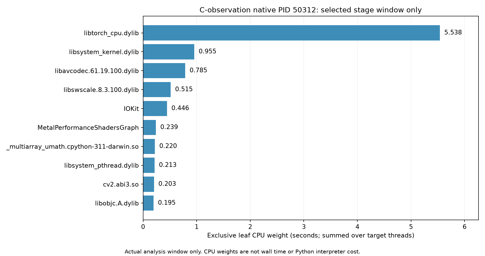
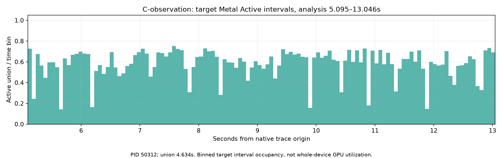
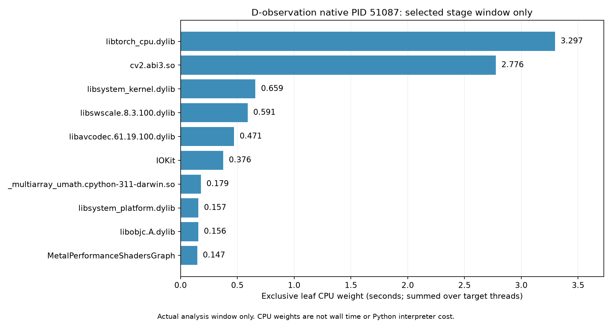
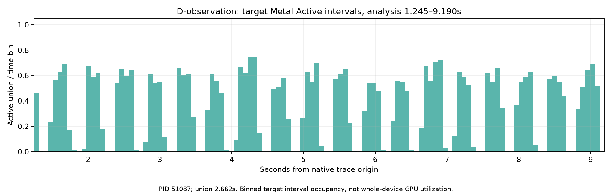
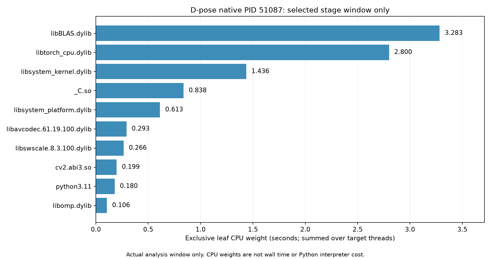
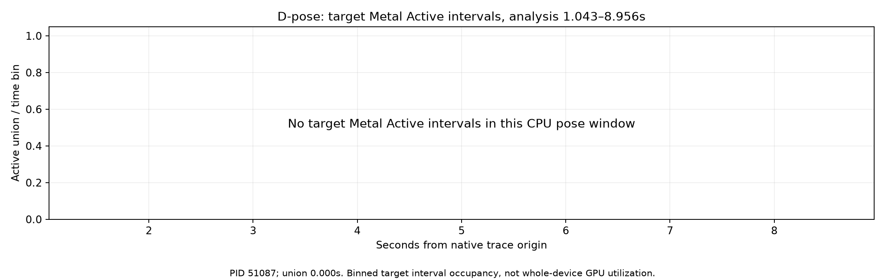

| 窗口 | 精简摘要 | 大证据 SHA 索引 | 原始 trace |
| --- | --- | --- | --- |
| C 找球 | [摘要](performance-baseline/native-C-observation.json) | [索引](performance-baseline/native-C-observation-artifacts.json) | [Instruments](../.runtime/performance-baseline/profile-control-C/observation.trace) |
| D 找球 | [摘要](performance-baseline/native-D-observation.json) | [索引](performance-baseline/native-D-observation-artifacts.json) | [Instruments](../.runtime/performance-baseline/profile-control-D/observation.trace) |
| D 姿态 | [摘要](performance-baseline/native-D-pose.json) | [索引](performance-baseline/native-D-pose-artifacts.json) | [Instruments](../.runtime/performance-baseline/profile-control-D/pose.trace) |

### 何时值得改 C++ 或 Rust

当前 PyTorch、FFmpeg、OpenCV 已执行大量原生计算；A 的 Python interpolate 栈与原生缩放内核互证，说明改写外层 Python 不会自动消除这些计算。PyTorch 官方说明其 Python 接口建立在大量 C++ 实现上，C++ 前端是互补选择，见[官方说明](https://docs.pytorch.org/tutorials/advanced/cpp_frontend.html)。该网页不代表本地安装新版，本地仍是 torch 2.8.0。

py-spy 在迁移后仍可定位 Python 调用路径和跨语言边界，但 macOS 不支持其内部 native 栈，见[平台支持](https://github.com/benfred/py-spy#can-py-spy-profile-native-extensions)。Python self 不能单独证明解释器瓶颈；原生 CPU 热点也不能替换 GPU 时间。

现有证据支持先拆分和减少前处理、转换、调用次数。只有更窄的 CPU 计时和原生栈确认具体 Python 循环或对象处理开销后，才对该小段做 C++/Rust 等价原型；C 当前整个主阶段上界仅约 3.6%–3.9%，且包含 NumPy/SciPy 原生调用，不能凭 inclusive 栈驻留断言解释器占满。跨语言要核算数组布局、拷贝、GIL/线程、异常和内存归属，增加的绑定与维护成本可能抵消收益。C++ 与现有 PyTorch/OpenCV 接口较直接，Rust 需评估绑定和数组所有权成本；本轮没有证据证明二者谁更快，也没有证据支持全模块语言迁移。上述仅为下一轮条件建议，本轮未实施优化。

## 复跑与核对证据

### 固定版本、输入与环境

测量基于提交 `979caeb1cefedd78b2cebac52ca38f28a84d7563` 加本任务未提交实现，测量前树摘要为 `b0dd82c61618c5b4b2f59a8011b0d43710e5383a9d811ccd1847ef40d0681adf`。报告文件会改变全树摘要，应比较共同实现文件 SHA，而非要求所有 manifest 的全树摘要相同。[冻结清单](../../../docs/ai/performance-baseline/controller/pre-measurement-freeze.json)保留逐文件值；[147 文件核对摘要](performance-baseline/implementation-freeze.json)确认当前工作区与五份运行 manifest 的共同实现、测试和配置完全一致。

[固定输入清单](performance-baseline/inputs.json)保存六份视频绝对路径、SHA、来源窗口、court、实际解码/音视频/连续性预检。容器时长、视频流时长、帧率与 PTS 原点分开；A 首 PTS 91ms、C 长 108ms、D 长 133ms 等不从时长猜测。连续性是抽样检查，不代表逐帧人工效果审核。

本机 macOS 26.5.1 arm64，18 个逻辑核心，Python 3.11.16、torch 2.8.0、torchvision 0.23.0、av 14.2.0、psutil 7.2.2、FFmpeg 7.1；MPS 可用，CUDA 不可用。完整依赖、算法 profiles/selection、权重和 FFmpeg SHA 在六正式摘要与原 manifest。保持原有采样、线程和自动设备，不以强制同步改变真实行为。

### 正式运行

在仓库根目录使用既有开发环境；输出路径必须是新的目录。先准备并校验权重与输入，正式模式默认统计开启，无采样器等待。以下命令已用于本轮流程，重跑时替换 `baseline-new` 等输出路径。

```sh
PYTHONPATH=apps/video-clipper/backend .venv/bin/python -m app.benchmark \
  --inputs apps/video-clipper/reports/performance-baseline/inputs.json \
  --cases A-short A-long C-short C-long D-short D-long \
  --models apps/video-clipper/.runtime/performance-baseline/prepared-models \
  --output apps/video-clipper/.runtime/performance-baseline/baseline-new \
  --report apps/video-clipper/.runtime/performance-baseline/baseline-new-results.json
```

runner 使用真实 HTTP 导入、处理、查询及 WebSocket 续租，每份输入新建后端、会话和 worker，顺序执行，归档后关闭会话。模型缓存先准备，但计时内仍执行产品正常校验和加载。

### 独立剖析与握手

Python 采样为三份短片完整产品流程，`--profile-wait --mps-signposts --no-statistics` 关闭聚合统计，保留外部资源与 MPS signposts；不生成空的假统计。此开关仅用于剖析。runner 写明确 `profile-ready.json`，采样器确认实际附加后创建其 `release_file`，才继续 worker。管理员只用于 py-spy，应用 UID 501。

C/D 使用[阶段控制器](../../../docs/ai/performance-baseline/controller/profile_runs.py)，C 找球、D 找球和 CPU 姿态阶段进入后等待四秒并复核阶段，再请求各八秒原生录制。以下为本轮实际入口，需要在新的任务工作树准备相同输入和权重，且控制目录与输出报告必须不存在；控制器支持 `--help` 查看参数。A 原生全段证据复用本轮已完成补录，不再启动全段巨型 trace。

```sh
.venv/bin/python docs/ai/performance-baseline/controller/profile_runs.py C-short
.venv/bin/python docs/ai/performance-baseline/controller/profile_runs.py D-short
```

上述控制器默认本轮固定路径，原目录已存在时不能直接覆盖重跑。手动模式先运行下列入口，再按 `profile-ready.json` 中明确的目标 PID、py-spy 参数和释放文件协调采样；不能把启动进程当作附加成功。

```sh
PYTHONPATH=apps/video-clipper/backend .venv/bin/python -m app.benchmark \
  --inputs apps/video-clipper/reports/performance-baseline/inputs.json \
  --cases A-short \
  --models apps/video-clipper/.runtime/performance-baseline/prepared-models \
  --output apps/video-clipper/.runtime/performance-baseline/profile-A-new \
  --report apps/video-clipper/.runtime/performance-baseline/profile-A-new-results.json \
  --profile-wait --mps-signposts --no-statistics \
  --py-spy-path /private/tmp/smash-performance-tools/bin/py-spy
```

### 解析与输出核对工具

采样结束并确认 trace 保存后，再解析已保存证据；解析和检查均不启动模型推理。当前公共实现集中在执行目录，原位置不保留重复入口：

| 工具 | 用途与运行边界 |
| --- | --- |
| [原生解析](../../../docs/ai/performance-baseline/controller/native_profiles.py) | 导出已完成的 trace 或复用既有 XML；显式确认录制已结束，使用新 run-id。`--windows` 处理 C/D 窗口，A 全段单独处理。 |
| [Python 摘要](../../../docs/ai/performance-baseline/controller/python_profiles.py) | 从已保存 SVG 解析调用路径、识别子树与采样错误；`--cases A C D` 显式选择场景。 |
| [输出核对](../../../docs/ai/performance-baseline/controller/validate_outputs.py) | 读取本轮十份既有输出、完整解码并比较区间与结构，创建新的 output-validation/run 证据；直接运行脚本，无 `--help` 入口。 |

### 时间、内存和证据边界


箭头表示顺序；正式总耗时只覆盖准备至成片。直接采用同一单调时钟的产品 `timings`，准备包含 worker 启动与 Python 导入；正常模型校验/加载保留在对应产品阶段。上传、缓存预备、归档和手动保存不计入。剖析包括握手/采样开销，不能作正式基线。

识别主阶段互斥，子项嵌套；源解码/转换可在另一线程并行，不能再加到主阶段。外部资源读取后端及递归子进程，包含实际采到的 FFmpeg、system_profiler 等；可能漏掉短命进程。MPS allocated/driver 仅识别上下文；观察峰值并非精确峰值，也不是最低硬件需求。

原始成片、逐秒资源、trace 与大 XML 留在应用 `.runtime`，以绝对路径、大小与 SHA/文件树 SHA 关联；小图、SVG、摘要保存在本报告目录。[证据索引](performance-baseline/evidence-index.json)给出定位信息。单个输入仅一次正式测量，不推断波动；不同来源短长片不能证明复杂度、内存泄漏或 30 分钟验收。后续优化须重测完整链路与识别效果。
