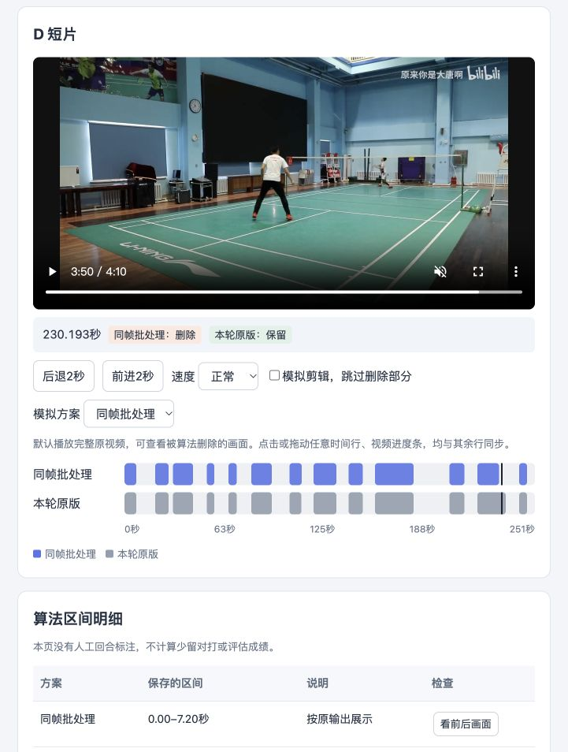
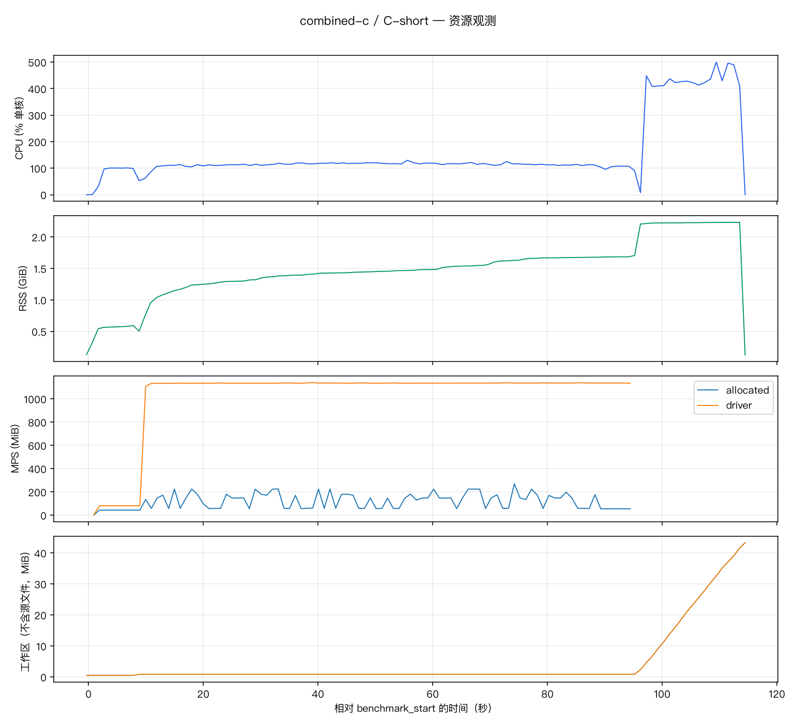

# 首轮性能优化报告

## 当前结论

2026-10-21，首轮独立验收已通过；本任务分支状态为“已完成，待人工确认”，等待人工确认集成，尚未合入或推送。

- **C 缓存验收通过并保留**：实际减少 5397 次重复单帧预处理，模型窗口和调用次数不变；完整区间、导出及音视频结构等价。缓存加删除复制的组合也等价。
- **两处 RGB copy 可简化**：真实输入的内存所有权、连续性、张量和单图输出严格相同。TrackNet 已通过 A 完整流程；姿态 copy 的 D 完整组合已等价，230.193秒点保持保留。
- **D 无条件同帧合批不通过**：本次更快，但提前截断了用户确认仍在回合中的画面，不能接受该变体。用户决定本轮暂缓采用，保留其提速潜力与证据；条件合批不实施。
- **D 细分计时有定位价值**：姿态入口几乎全部落在模型调用；诊断本身不算提速。

实施范围与效果边界见[首轮方案](../../../docs/features/performance-optimization/first-round.md)。[原性能基线](performance-baseline.md)及其证据保持不变。

## 完整剪辑测量

使用原基线相同 SHA 的 A/C/D 短片、模型与设备、线程、采样和 balanced 导出；每次新任务重新加载模型，计入正常校验、识别和编码。候选各单次；原版因异常追加一次对照，全部串行运行。本轮不重测长片，也不重录剖析。

| 版本 | 准备（秒） | 识别（秒） | 成片（秒） | 总计（秒） |
| --- | ---: | ---: | ---: | ---: |
| D 原版＋细分计时 | 0.55 | 304.74 | 13.10 | **318.38** |
| D 无条件同帧合批（暂缓） | 0.55 | 277.60 | 12.80 | **290.95** |
| C 仅缓存 | 0.43 | 94.11 | 19.49 | **114.03** |
| A 仅删除 TrackNet copy | 0.48 | 33.38 | 9.71 | **43.56** |
| C 缓存＋删除 TrackNet copy | 0.42 | 95.12 | 19.16 | **114.69** |
| D 保留组合（逐人、两处 copy 简化） | 0.54 | 282.57 | 12.83 | **295.94** |
| D 相同原版追加对照 | 0.51 | 325.75 | 12.97 | **339.24** |

历史单次总耗时为 A 48.05 秒、C 137.17 秒、D 335.08 秒。本轮原版 D 已为 318.38 秒，说明跨运行环境差异不可忽略。缓存减少的工作量有实测支持；C 总计减少的全部秒数和 A 总计差异不能都归因于本项优化。删除 copy 后的 C 组合 114.69 秒与缓存单项 114.03 秒没有可解释的速度改善；保留依据是严格等价及少一次复制。

D无条件合批首次对照总耗时少27.43秒（8.62%），模型调用2432→1255次；它因误删而本轮暂缓。随后恢复逐人推理的最终组合也降到295.94秒，降时主要发生在模型调用内部，远超复制简化的输入准备成本。为避免误归因，按方案额外补了一次相同原版：

- 同一原版两次总耗时分别318.38与339.24秒，模型调用分别159.31与175.13秒；被测源码、依赖快照、配置、输入与权重一致，工作量和输出也一致。
- 最终组合的模型调用为138.44秒，输入准备0.34秒；首次原版输入准备0.45秒。整段降时不能全部归因于删除copy。
- 具体运行时波动原因未定位，现有数据不能准确量化批处理的独立墙钟收益；8.62%仅是首组单次差额。批处理减少模型调用的事实和方向价值保留，后续算法稳健性改善后，应重新做配对测量。

[原版对照核对](../../../docs/ai/performance-first-round/controller/d-control-comparison.json)。本轮不据单次差额或两次原版观察推断稳定波动范围、长片扩展或30分钟验收。复制简化的保留依据是输入/输出严格等价及实证少一次复制，未承诺确定提速比例。

## 各项证据

### D 姿态入口分解

| 原版细分项目 | 累计时间（秒） | 口径 |
| --- | ---: | --- |
| 包装器输入准备 | 0.4523 | BGR→RGB、转张量、浮点和除以255 |
| 模型调用 | 159.3075 | 包含模型内部归一化、缩放、网络与原生运算 |
| NumPy 结果转换 | 0.0251 | 取出模型结果 |
| 整个姿态包装调用 | 159.8127 | 父项，包含包装开销；不与前三项相加 |

模型调用约占包装调用 99.7%。这不能称为纯网络卷积时间，也不能称为 Python 自身执行时间。外层全部输入准备及结果转换仅约 0.48 秒，不支持优先把该外壳迁移到 C++/Rust；是否改写内部热点仍需原生算子与 Python 自身成本证据。

姿态解码 7.5064 秒、整帧转换 6.4229 秒分别在包装调用之外；不得用这两项重新拆分历史包装器占比。计时开启/关闭路径测试和原版完整区间对照通过，独立复验通过。

### D 无条件合批的失败案例

同帧有效裁剪数不变，共 2432 张：1177 个双图批次和 78 个单图批次。模型线程、CPU、裁剪、阈值及映射规则未变。

| 原始回合段 | 原版结束（秒） | 合批结束（秒） | 判断 |
| --- | ---: | ---: | --- |
| 第7段，起点100.9秒 | 108.0 | 108.4 | 延后0.4秒；未单独完成人工效果确认 |
| 第12段，起点215.7秒 | 233.0 | 229.0 | 提前4.0秒；明确误删，效果不通过 |

**用户确认：230.193 秒处“球还没落地，理论上应该是强置信回合中”。** 合批原始结束为229.0秒，即使加原有0.5秒尾部缓冲，仍不覆盖该时间点。这里只记录用户确认的回合中时间点，不补造完整人工起止、不计算整片准确率。



真实裁剪探针显示，合批可能改变某个裁剪的补边尺寸及模型输出，部分关键点偏差较大。这提示了输入补边与输出扰动的关系，尚未证实是误删的唯一原因。用户提出先改善原有算法逻辑，之后可能规避误删；该假设有后续研究价值，但尚未验证。本轮暂缓批处理，后续应检查姿态扰动如何传递到结束判断，算法稳健性改进后重新评估。后续变体必须重新检查该案例及全部输出；回合逻辑改进和批处理应分别测量，再组合验证。[边界及人工判断记录](performance-first-round/d-batch-changes.json)。

复看入口（在本任务 worktree 根运行，数据和原片均保留）：

```sh
.venv/bin/python .agents/skills/review-video-results/scripts/review.py \
  --data modules/rally/.runtime/performance-first-round/review.json --port 0
```

### C 重叠帧缓存

| 工作量 | 无缓存路径 | 本轮缓存单项 |
| --- | ---: | ---: |
| 模型调用（次） | 3599 | 3599 |
| 模型图像输入（张） | 10797 | 10797 |
| 实际准备单帧张量（次） | 10797 | 5400 |
| 复用已准备帧（次） | 0 | 5397 |
| 缓存张量观测最大数量（帧） | 0 | 3 |

最多三个CPU float32张量本体为5.0625 MiB；这是张量大小，不是进程额外内存上限。仅C传入真实帧号启用，任务观测结束或异常时清空。4组真实窗口的输入张量、热图和候选严格相同；普通、重叠及片尾窗口保持原顺序。完整单项与旧C等价，组合与单项等价。

TrackNet 预处理历史为18.06秒，本轮缓存单项为9.22秒，组合为9.36秒；该项嵌套于视频观测，不能与总计重复相加。

### 两处 RGB copy

OpenCV 颜色转换已经返回独立、连续的数组；真实帧/裁剪检查输入未改变，RGB与张量严格相同。姿态实际8个裁剪的单图输出也严格相同。只删额外复制，保留必要颜色转换、缩放及模型内部搬运。

这些探针不能替代完整效果检查。TrackNet 的 A 单项及 C 组合已完整对照通过；姿态 copy 的 D 完整组合也已等价。未据微小计时差声称稳定提速。

## 资源观测

每秒观察后端、识别和编码进程；最高值均为**采样观测值**。CPU以一个逻辑核心100%计，RSS是进程合计且共享页可能重复计数；MPS分配与driver口径单列，不与RSS相加。工作区列扣除导入源文件；不含源文件及含源文件的完整口径均保留在CSV。

| 版本 | CPU观测峰值（%单核） | RSS观测峰值（GiB） | MPS分配 / driver观测峰值（MiB） | 工作区观测峰值（MiB，不含源文件） | 样本（个） / 最大间隔（秒） |
| --- | ---: | ---: | ---: | ---: | ---: |
| D 原版＋细分计时 | 475.5 | 2.225 | 223.3 / 1139.0 | 20.66 | 315 / 1.025 |
| D 无条件同帧合批（暂缓） | 472.3 | 2.458 | 244.3 / 1139.0 | 20.21 | 288 / 1.028 |
| C 仅缓存 | 507.8 | 2.240 | 224.5 / 1137.3 | 43.28 | 114 / 1.022 |
| A 仅删除 TrackNet copy | 539.8 | 1.243 | 210.3 / 1111.8 | 16.43 | 45 / 1.021 |
| C 缓存＋删除 TrackNet copy | 499.8 | 2.232 | 268.9 / 1139.6 | 43.28 | 114 / 1.020 |
| D 保留组合（逐人、两处 copy 简化） | 503.2 | 2.199 | 304.2 / 1135.7 | 20.66 | 293 / 1.020 |
| D 相同原版追加对照 | 468.5 | 2.220 | 304.2 / 1138.9 | 20.66 | 336 / 1.027 |

七次资源采样均未记录采样错误；短暂进程和瞬时峰值仍可能漏采。MPS曲线只覆盖识别进程存活期间，结束后的空白不表示零。完整资源数值、剩余磁盘最小值和各版本曲线见[JSON](performance-first-round/measurement-summary/summary.json)、[CSV](performance-first-round/measurement-summary/summary.csv)。



## 验证、来源与剩余工作

- 六次等价检查通过：D原版计时对旧D、C缓存对旧C、A复制简化对旧A、C组合对缓存单项、D最终组合对本轮原版、追加原版对首次原版；均比较原始区间、导出范围、质量、缓冲、警告及完整音视频解码和时间戳。[核对结果目录](performance-first-round/validation/)。D无条件合批的不同输出同样完整解码，差异证据保留，未记通过。
- 撤回批处理后的最终保留源码后端Python测试106项通过、1条既有Starlette警告。`pnpm run test:backend`在执行Python前触发JS自动安装，被依赖供应链校验阻止；未改锁文件或放松策略，直接执行package.json声明的`.venv/bin/python -m pytest`完成同一套Python测试。未改前端，未跑前端检查。
- [固定输入](performance-first-round/inputs.json)和原权重SHA沿用基线；每个测量版本用增量补丁与源文件SHA冻结，运行前后源文件未变，应用以普通用户运行。
- 原始运行与数值探针保留在本任务`apps/video-clipper/.runtime/performance-first-round/`；源码冻结、可复跑控制脚本与逐次记录在[执行目录](../../../docs/ai/performance-first-round/controller/)。

最终D保留组合的回合、导出和姿态信号均与OPT01等价，230.193秒回合中时间点已覆盖。独立验收确认56个冻结文件SHA匹配，功能、代码及文档检查通过；真实MPS下C四窗口与无帧ID探针严格一致，最终D区间、导出和保存姿态信号与原版相同。详见[独立验收记录](../../../docs/ai/performance-first-round/verifier/output.md)。本任务分支状态为“已完成，待人工确认”，等待人工确认集成；尚未合入或推送。
