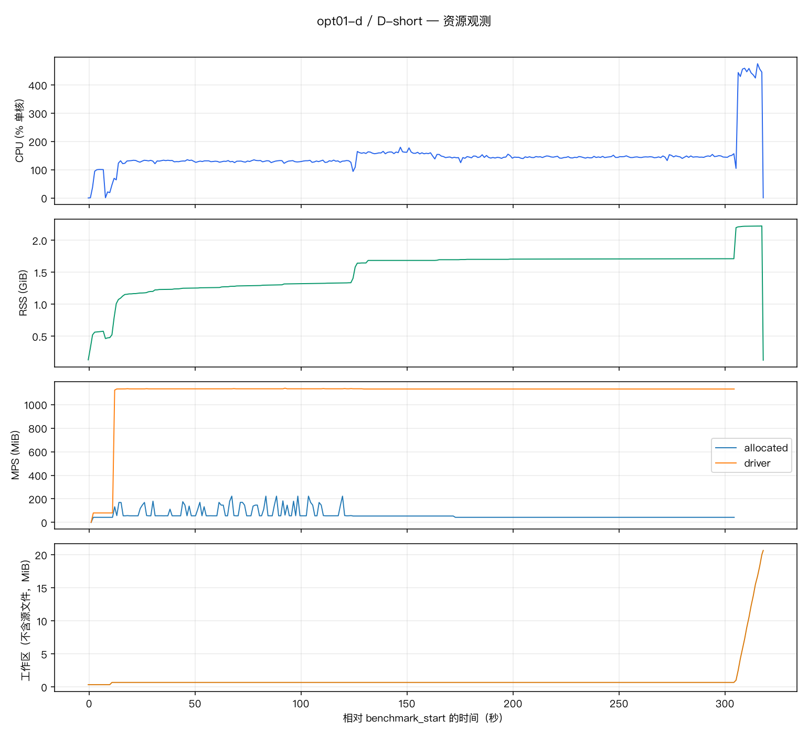
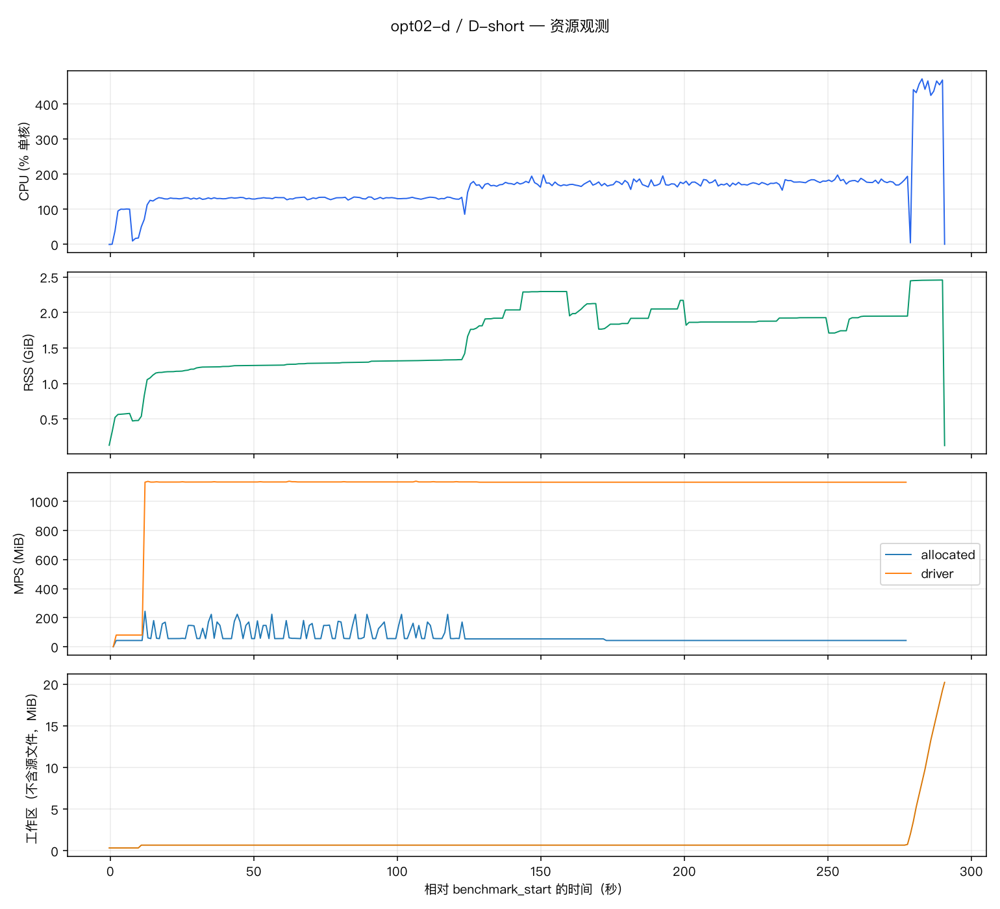
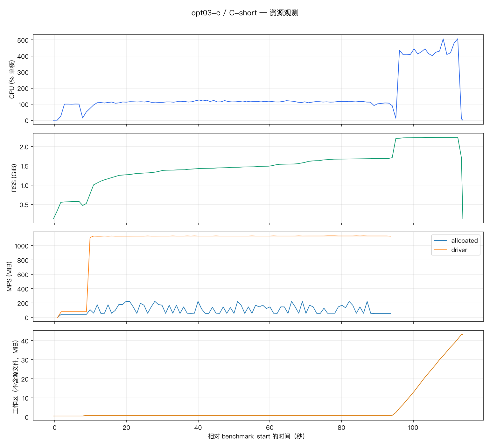
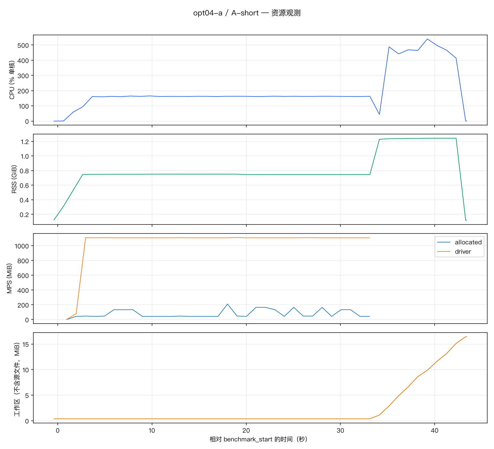
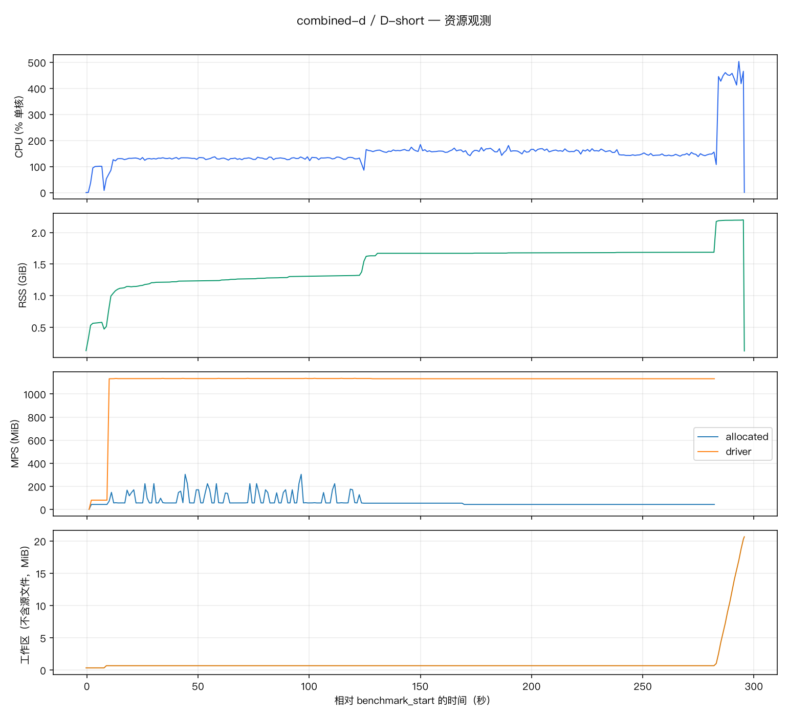
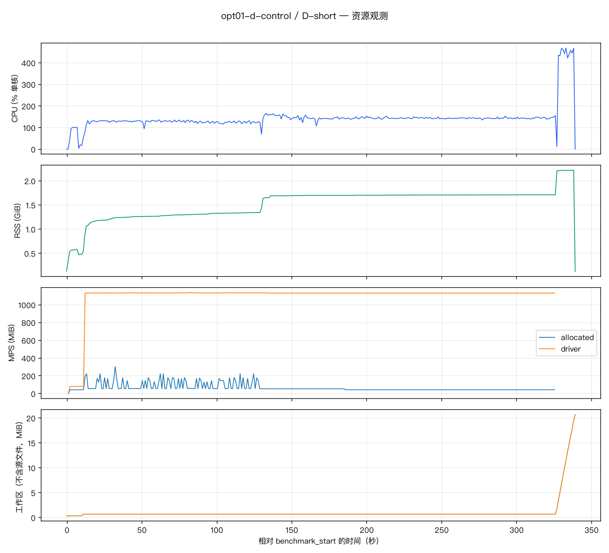

# 首轮性能证据索引

[返回首轮性能优化结论](../../../../docs/features/performance-optimization/reports/first-round.md)。本页只索引已有测量与效果证据，不复制原始数据或结论分析。

## 测量记录

下列七次记录均收录在[测量汇总 JSON](measurement-summary/summary.json)和[测量汇总 CSV](measurement-summary/summary.csv)中；[固定输入](inputs.json)记录本轮输入。

## 效果核对

六项核对结果等价；D 批处理效果不通过。

| 版本 | 核对记录 | 结果 |
| --- | --- | --- |
| D 计时原版 | [opt01-d.json](validation/opt01-d.json) | 等价 |
| D 批处理 | [opt02-d.json](validation/opt02-d.json) | 不通过：结果有差异 |
| C 预处理复用 | [opt03-c.json](validation/opt03-c.json) | 等价 |
| A 删除复制 | [opt04-a.json](validation/opt04-a.json) | 等价 |
| C 递进版本 | [combined-c.json](validation/combined-c.json) | 等价 |
| D 最终逐人版 | [combined-d.json](validation/combined-d.json) | 等价 |
| D 原版重复对照 | [opt01-d-control.json](validation/opt01-d-control.json) | 等价 |

## 资源曲线

七次测量的既有资源曲线：

D 计时原版（D-short）

D 批处理（D-short）

C 预处理复用（C-short）

A 删除复制（A-short）

C 递进版本（C-short）

D 最终逐人版（D-short）

D 原版重复对照（D-short）

## 误删案例

[误删边界数据](d-batch-changes.json)记录本轮确认范围：用户确认 230.193 秒时仍处于回合中；这不是完整回合标注或整片准确率结论。

查看 230.193 秒画面

