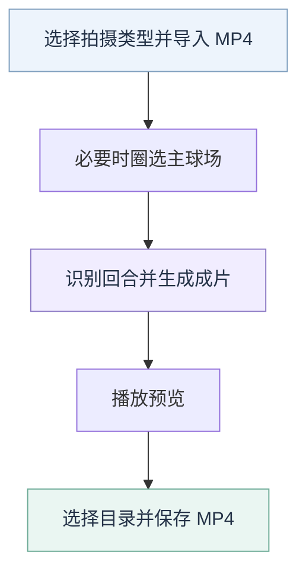

# 自动剪辑产品需求

让用户将一份羽毛球录像变成删除间歇、保留原声音的连续视频。程序在本机运行，首版交付 macOS Apple 芯片测试包。

运行与开发方法见[应用说明](README.md)，当前进展见[路线图](../../docs/plan/roadmap.md)。

## 使用流程

## 首版范围

| 项目 | 要求 |
| --- | --- |
| 输入 | 一份横屏、固定机位、单打 MP4；验证目标约 30 分钟、最高 1080p，其他编码或尺寸明确提示 |
| 拍摄类型 | 比赛高视角、场边低视角、个人斜侧方 |
| 输出 | 连续 H.264/AAC MP4，保留原尺寸及原音画相对偏移；无音频输入输出无声成片 |
| 界面 | 新建 ReactLynx 页面，通过 Lynx for Web 加载；预览区避免重复品牌、装饰标题和保存提示 |
| 球路开关 | 仅比赛高视角显示“在成片中显示球路”，默认开启、允许关闭；其他拍摄类型不显示且不运行球路分析 |
| 保存 | 预览后通过系统窗口选择目录与文件名；浏览器首版支持 Chrome/Edge 的流式文件保存 |
| 运行 | 服务只监听 `127.0.0.1`；独立包包含 Python、FFmpeg 和静态网页，不依赖仓库或开发服务器 |

首版不包含时间轴编辑、手动修正区间、历史任务、账号、双打或 Android 采集接入；不采用 Electron。

## 识别与成片

| 环节 | 要求 |
| --- | --- |
| 识别 | 调用回合、模型与媒体模块，记录方案来源；不从实验目录、测试入口或人工标注加载运行逻辑 |
| 方案 | 原 A、已确认的 C/D，完整配置由[回合模块](../../modules/rally/README.md#场景方案)维护 |
| 时间轴 | 保留实际源帧时间戳；流式与离线方案按各自要求处理，未确认结束的流式候选不补造区间 |
| 补时 | 原始区间独立保存；导出时每段前后各补 0.5 秒，裁到源范围，排序并合并重叠 |
| 画质 | 高画质、均衡、小体积三档，默认均衡；编码质量参数 CRF 初值为 18/23/28，值越小通常画质越高、体积越大 |
| 球路叠图 | 开启时将逐拍球路烧录到最终 MP4；右上角显示完整单双打场地线和统一颜色的当前拍箭头，下一拍替换当前箭头，回合外不显示旧箭头；每回合非末拍的起终点都在含边线的单打场内并分处球网两侧，末次真实击球豁免。违规起点先用同侧人物在击球时刻的位置修正，缺少精确时刻时仅在前后同侧记录均距击球不超过 220 毫秒时插值；违规终点优先用下一次真实击球起点，仍无效时用该击球者的人物位置。修正或替代后仍不合规则隐藏箭头，不裁边或制造坐标 |

完成摘要展示准备、识别、生成成片和总耗时，使用实际分秒；处理进度条保留。准备包含首次资源下载，总耗时从开始自动剪辑到成片就绪，不含导入及手动保存。刷新恢复统计，新任务清空旧值。

## 高级选项

成片质量下方提供默认收起的“高级选项”，收起时显示已启用数量。展开后用两列按钮选择，启用项整块高亮，每项附简短说明；上传和处理期间锁定选择。

| 配置 | 比赛高视角 | 场边低视角 | 个人斜侧方 |
| --- | --- | --- | --- |
| 限制识别帧率至 35fps | 开启 | 开启 | 开启 |
| 缩小找球图像至最长边 320 | 开启 | 开启 | 开启 |
| 灰度找球 | 开启 | 开启 | 开启 |
| 动态粗筛 | 开启 | 关闭 | 关闭 |

以上为各场景初始值，从未展开高级选项也按此执行。四项在所有场景均可独立切换和组合，不改变成片尺寸、帧率、声音及每段前后各 500ms 补时。默认值是产品选择；各配置的识别效果与处理成本分别记录。

当前标签页分别保存各场景的选择，切回场景、刷新或更换录像后恢复；新标签页使用默认值。旧会话缺失的字段按场景补全，明确关闭的值保留。展开、收起只影响显示。

`POST /api/sessions/{id}/run` 的 `optimizations` 包含 `limit_fps`、`small_input`、`grayscale`、`dynamic_scan`。请求省略对象或部分字段时，后端补全上述默认值。任务状态和结果记录完整实际配置，后续选择不改写已执行任务。

## 临时文件与模型

| 对象 | 生命周期 |
| --- | --- |
| 标签页任务 | 随机临时凭证隔离，无全局任务列表；断连或刷新允许 60 秒恢复 |
| 源录像、中间数据、临时成片 | 超时取消进程并清理；服务退出清理，下次启动处理异常退出遗留目录 |
| 已保存成片 | 保留，不随会话清理 |
| 模型缓存 | 与工作目录分开；首次从固定公开来源下载，展示进度并核对版本、大小和 SHA256；失败可重试，之后离线复用 |

## 验收要求

| 类别 | 需要验证的内容 |
| --- | --- |
| 识别 | 三类选定方案的结果复现和真实模型运行，记录算法与参数版本 |
| 使用流程 | 导入、主场选择、识别、取消、失败提示、预览、系统保存 |
| 会话 | 双标签页隔离、刷新恢复、超时和退出清理 |
| 成片 | 三档画质的切点、尾帧、声音偏移、可播放性和文件大小 |
| 处理成本 | 约 30 分钟 1080p 的完整耗时、内存、磁盘及输出大小 |
| 独立包 | 仓库之外启动、模型下载和断网处理 |

本机测试包验收、算法效果验收与公开发行分别记录。公开授权、签名和公证需另行处理；本次文档整理后的入口快速检查不重做整套产品验收。
