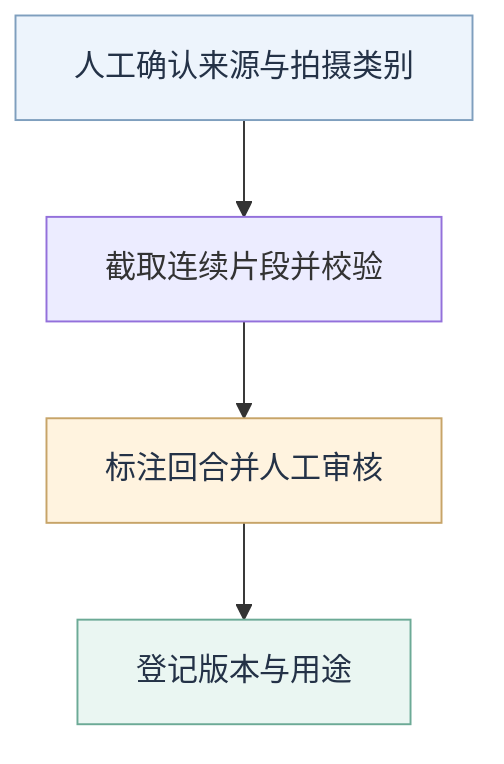

# 测试数据与标注规范

统一记录素材从哪里来、审核过什么，以及结果能用于调试还是独立验收。实际文件位置见[数据集目录](README.md)。

## 数据准备流程

## 素材清单

| 必须记录 | 内容 |
| --- | --- |
| 来源与身份 | 样片标识、来源录像、拍摄类别与人工确认结论 |
| 时间信息 | 截取窗口、实际时长、源时间轴、原帧率或时间戳生成方式 |
| 关联文件 | 视频校验值、标注版本、可用辅助信息 |
| 数据用途 | 调试、同来源留出检查或独立验收；来源与拍摄会话分组 |

分组字段 `split_group_id` 用于隔离相关场馆或拍摄会话。独立验收不能与调参共享来源或相关会话；同源留出检查须明确标为诊断，查看后再调参就不再是未见结果。

每类测试时长及连续性要求见[回合评估规范](../modules/rally/evaluation.md#回合算法测试视频)。

## 回合标注

| 字段 | 含义 |
| --- | --- |
| `rally_id` | 回合标识 |
| `start_ms`、`end_ms` | 源时间轴上的起止时间，单位为毫秒 |
| `review_status` | 审核状态；正式计分只使用 `verified` |

- 按[回合边界定义](../modules/rally/requirements.md#回合边界)记录；不确定边界保留范围、原帧和待审状态。
- 保守代表值取起点范围左端、终点范围右端，保留原范围及人工决定。
- 更正标注时另存版本和依据，保留原版；新清单引用新版及校验值，再用同一预测重评，区分标注变化与算法改善。
- 旧标注的 `verified` 不自动代表已按新边界定义复核。部分审核之外的内容不能自动当成无回合负例。

## 种子输入

| 资产 | 位置 |
| --- | --- |
| 视频 | `badminton-v1/local/ysp/test_ysp.ts` |
| 清单 | [rally-benchmark.json](badminton-v1/manifests/rally-benchmark.json) |
| 人工标注与主场区域 | `badminton-v1/annotations/seed/ysp/` |

种子素材已用于历史诊断，清单用途为 `diagnostic`，不能作为新的独立验收来源。清单保留帧数、时长、恒定帧率时间戳生成方式、标注版本及主场区域信息；主场区域是可用元数据，不强制所有算法依赖它。旧观测、参数和效果结论不自动成为新基线。

## 辅助训练与诊断数据

球场几何与人员轨迹用于候选调研，不代替回合评估。下列要求在相关任务恢复时适用，当前安排见[路线图](../docs/plan/roadmap.md#后续方向)。

| 项目 | 已有要求 |
| --- | --- |
| 多样性 | 按独立场馆机位统计，不按同场比赛帧数统计 |
| 流程验证 | 10 个已审核独立机位，用于确认采集、审核、拟合和标注闭环 |
| 首个可训练基线 | 30 个已审核机位，其中至少 24 个非转播机位、12 个隔离分组；只是学习曲线起点 |
| 后续补充 | 按错误类型和学习曲线每轮增加 10 个机位，优先补薄弱场景 |
| 困难场景 | 邻场、额外人员、遮挡或出画各至少 5 个已审核独立机位；专业转播不计入 |

球场与人员标注的具体规则

- 球场人工标注只包含可明确识别的标准控制点；至少 4 个非共线点才能拟合球场平面与图像的映射。
- 模型生成的点位提案须保留原提案、模型版本、提示词版本和输入帧哈希；人工审核另存。含不确定点的提案不能直接进入草稿。
- 人工逐点接受或修正后可进入草稿，点位来源仍为 `manual`，另记 `annotation_origin=model_assisted_human_verified`。
- 几何拟合可产生画幅外六点，来源区分 `manual` 与 `geometry_inferred`；推断点须人工确认并明确允许后，才可用于弱监督训练。
- 人员轨迹使用通用 `person`，附 `role=participant|non_participant|unknown` 和 `court_side=near|far|outside|unknown`。
- 人员任务关联已审核球场几何，不能把场外人员静默当作检测负例。数据切分同时隔离来源与 `split_group_id`。

详细字段与操作流程见仓库的[素材整理技能](../.agents/skills/curate-badminton-training-data/SKILL.md)。审核记录与配套数据放在 `reports/`。
