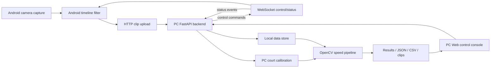
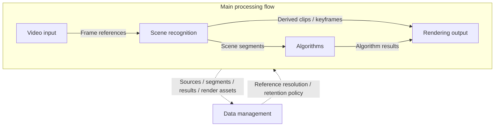

# 架构设计

Smash Suite 是一个本地优先的羽毛球视频套件。当前 demo 聚焦杀球测速，但架构需要为普通回合剪辑、慢动作输出、训练复盘和可分享媒体保留扩展空间。

## Demo Architecture

MVP demo 拆成两个运行角色：

- **Android 智能摄像头节点**：高帧率采集、粗时间线过滤、上传保留片段。
- **PC 测速工作站**：控制 Android、接收片段、完成场地标定、运行测速分析、管理资产、展示结果。

Demo 阶段 Android 不负责产品 UI、场地标定、最终测速、结果展示或导出；这些职责都留在 PC。

默认运行通道：

- 网络 ADB 负责从 PC bootstrap Android service 生命周期。
- WebSocket 负责低数据量控制、心跳、能力和状态事件。
- HTTP 负责上传保留视频片段和 manifest。

## Demo 职责边界

| 能力 | Android | PC |
| --- | --- | --- |
| 服务生命周期 | 被 PC 通过网络 ADB 启停。 | 负责 bootstrap 脚本和操作入口。 |
| 采集 | 负责相机访问、高帧率采集、本地 ring buffer。 | 下发采集配置并监控状态。 |
| 场景过滤 | 做粗时间线过滤，降低数据量。 | 调整参数并验证输出质量。 |
| 片段上传 | 上传保留片段和 manifest。 | 接收、存储、索引和分析片段。 |
| 场地标定 | 不负责。 | 抽取预览帧，负责四点标定 UI/API。 |
| 测速分析 | Demo 阶段不负责。 | 运行 OpenCV baseline，后续接入模型适配器。 |
| 结果 UI | Demo 阶段不负责。 | 展示速度曲线、峰值、轨迹、关键帧和导出。 |
| 数据管理 | 临时 ring buffer 和上传队列。 | 源片段、manifest、session、结果、导出和验证数据。 |

## 时间线数据策略

Android 将连续相机时间线按价值分层。第一版实现必须保守、可配置。

| 类别 | 含义 | Android 处理 | PC 用途 |
| --- | --- | --- | --- |
| `idle` | 无效非运动场景。 | 丢弃，或只保留低频 metadata/log。 | 通常不用。 |
| `rally` | 普通运动回合。 | 上传低帧率压缩片段。 | 后续剪辑和复盘。 |
| `smash_candidate` | `rally` 内部的疑似杀球或高速事件候选区间。 | 在 `rally` 内额外保留高帧率 pre-roll/post-roll 片段。 | 测速、慢动作、关键帧复核。 |

过滤算法在真实 Android 样片验证前不能定型。第一版从低分辨率灰度帧差、背景差分、运动像素比例、连通区域面积、短窗口运动能量、平滑窗口和冷却时间开始。

## 长期架构

长期产品仍围绕五个模块展开：

### Video Input

负责接入不同视频来源，并标准化帧访问、时间戳和媒体元数据。

长期输入可以包括：

- Android 摄像头节点。
- 本地视频文件。
- 本地摄像头。
- 设备直出的 YUV 流。
- RTSP、USB 采集卡或外部传感器。

### Scene Recognition

负责裁剪无效时间、识别有价值场景，并尽量输出轻量场景引用，而不是过早生成大量新视频文件。

长期场景类型可以包括：

- Idle / non-play。
- Rally。
- Smash candidate。
- Smash confirmed。
- Long rally。
- Highlight candidate。

### Algorithms

消费场景片段并计算指标。第一个指标是杀球速度；后续可以扩展击球次数、落点、回合节奏、球员移动或模型化羽毛球检测。

算法层需要允许 baseline 和模型实现并存，方便对比和替换。

### Rendering Output

将场景结果和算法结果组合成用户可消费资产：

- 速度曲线。
- 带叠加层的视频。
- 关键帧。
- 回合片段。
- 杀球慢动作。
- 可分享导出内容。

渲染输出应复用已存源引用和算法结果，不重复做识别和测速。

### Data Management

负责契约、存储、保留策略、缓存、派生资产、导出和验证样片。

数据管理应优先传递引用和结构化 metadata，避免重复复制大体积媒体。

## 数据契约

Demo 阶段的数据契约保持薄而可变。实现压力暴露出真实形态后，再更新契约。

当前目标契约：

- `DeviceState`：Android device id、连接状态、服务状态、电量/存储提示、最近心跳。
- `CaptureConfig`：camera id、目标 fps、分辨率、codec、ring buffer 长度、过滤阈值。
- `ClipManifest`：clip id、device id、时间线类别、时间范围、fps、分辨率、codec、触发原因、置信度、pre/post roll。
- `SceneGateEvent`：事件时间、类别、触发原因、score/confidence、可选 clip id。
- `SceneSegment`：主时间线分段，`category` 为 `idle` 或 `rally`，包含 `start_ms`、`end_ms`、`confidence`、`reason`、`source_frame_range` 和嵌套 `smash_candidates`。
- `SceneCandidate`：`rally` 内部候选区间，第一版 `category` 为 `smash_candidate`，包含时间范围、触发原因、置信度、源帧范围和父 segment 索引。
- `SceneGateResult`：视频 metadata、采样配置、ROI/阈值配置、分类时长、保留比例、`SceneSegment[]` 和 `SceneCandidate[]`，用于样片验证和后续 Android 迁移对比。
- `SceneGateEvaluation`：manual annotation 路径、预测路径、容差、precision、recall、F1、IoU、hit rate、漏检区间和误报区间，用于比较 motion baseline 与 SoloShuttlePose / TrackNet / hitting-event 等模型候选。
- `ExternalModelArtifactManifest`：外部模型名称、运行状态、输入视频、raw 输出目录、命令、返回码、artifact 清单、adapter 解析状态和下一步提示，用于 PC-only model spike 的可复现记录。
- `CalibrationConfig`：image points、world points、fps、court profile。
- `AnalysisResults`：轨迹点、速度样本、关键帧、导出路径。

长期契约可以扩展为：

- `MediaSource`
- `FrameReference`
- `SceneSegment`
- `DerivedClip`
- `AlgorithmResult`
- `RenderAsset`
- `StoragePolicy`

在 demo 真正需要前，不要强行把长期命名塞进代码。

## 当前实现参考

当前可运行 baseline、架构缺口、验证证据和下一步执行顺序统一维护在 `docs/plan/roadmap.md`。本文档只记录相对稳定的职责边界、数据流、传输方式、存储策略和目标契约。

## 维护规则

- 里程碑进度和证据更新到 `docs/plan/roadmap.md`。
- 只有职责边界、数据流或契约变化时，才更新本文档。
- 除非路线图明确改变，否则 PC 始终是 demo 产品入口和控制中心。
- Android 端算法在验证样片证明前保持 tentative。
