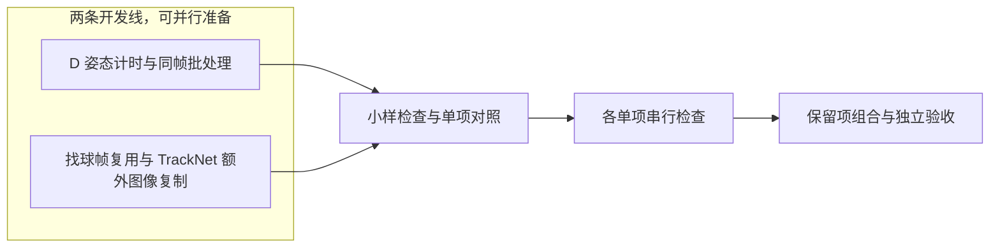

# 首轮性能小改方案

## 当前状态

2026-10-21 用户已确认集成 OPT-03/04，当前准备合入，尚未合入或推送。OPT-01 仅保留诊断结论和历史证据；细分计时代码只用于测量，不纳入产品。OPT-02 暂缓，等待 D 找球后的算法稳健性改善后再评估。原两条开发线和独立验收已结束；保存的测量版本包含 OPT-01 诊断，交付代码仅包含 OPT-03/04，未为删诊断后的交付版新增性能测量。详见[阶段报告](reports/first-round.md)。

首轮具体改动与验证安排已确认，效果边界沿用专题中已确认的规则。组合验证已纳入规划，具体组合取决于实际保留的候选；不提前用固定总次数代替各项所需证据。模型与完整测量按单项交付顺序串行调度。

本轮只包含专题入口中的 OPT-01 至 OPT-04。D 局部粗筛、D 第二遍解码复用、C 关联等后续方向不属于首轮实现范围。

范围、已确认的效果边界和全部候选方向见[专题入口](README.md)；测量依据见[原性能基线](../../../apps/video-clipper/reports/performance-baseline.md)。

## 工作分线与阶段

D 线负责 `person_signals` / Keypoint R-CNN 和姿态路径中的额外图像复制核查；找球线负责 `observe` / TrackNet、C 帧复用和 TrackNet 额外图像复制核查。共同识别入口的合并由同一人协调，避免两线无协调地改同一段代码。开发角色使用低成本 agent，主控协调；两线准备可并行，小样检查、真实模型探针和资源测量串行。独立验收前冻结实现并暂停开发。

箭头表示阶段顺序。计时、真实模型探针和资源测试依次执行，避免 CPU、GPU 与内存争用；编码仍计入完整处理。

## 四项改动边界

### OPT-01：细分 D 姿态入口计时

本节记录历史测量设计；该诊断实现不属于当前产品 API，也不纳入本轮交付代码。

复用已有 `Statistics` 聚合记录，不让每个调用点另写日志。保留 `pose_inference_s`（整个 pose 模型包装调用）和 `pose_calls` 原口径，在包装调用内部增加图像输入准备、模型调用、结果转换的时间项。模型调用仍包含模型自带的归一化、缩放和网络运算，不能称为纯卷积时间。

裁剪后的人物匹配与坐标回映射若有必要可单列；它们在包装调用之外，不计入历史 D-short 的 162.02 秒姿态入口时间。帧解码与整帧转换沿用已有统计。记录裁剪数、模型调用数和批次图像数等工作量。子项嵌套，不能与父项重复相加。

保持 CPU 路径，不加 GPU 强制同步或新采样器。用计时开启与关闭的数值、数据路径检查验证观测；原版完整 D 结果还须与历史基线的区间及导出结构比较。诊断本身不承诺提速，也不宣称计时开销精确为零。

### OPT-02：D 同帧最多两人 CPU 批处理

对同一个取样帧中的主球员处理，最多两名：没有有效裁剪时跳过，一张图沿用单图调用，两张图才组成一批 CPU 调用。输出逐图关联回原 `player_id` / `box_index`，保留 IoU 筛选、阈值、坐标回映射和 LK 流程。

当前 Keypoint R-CNN 已走 CPU，本项只改现有 CPU 路径。保持权重、线程、采样、裁剪扩边、模型缩放和精度。唯一试验变量是逐人调用与同帧两图调用，不跨帧攒批。记录图片输入尺寸与 padding；为同批尺寸补边可能增加计算或改变结果，不能预设两张图获得两倍速度。保留内部单图调用能力，不新增公开请求开关或通用批处理框架。

历史实施前要求先保存 OPT-01 原版细分计时。批处理测量使用该版本作为实验对照；不能把批处理后的计时伪装成原版分解。

### OPT-02 前置依赖与恢复条件

OPT-02 因批处理输出漏掉用户确认仍在回合中的 230.193 秒点而阻塞。前置工作是改善 D 找球后的姿态/动作证据到回合结束判断对扰动的处理，检查姿态/动作证据变化如何影响结束判断，避免误删该确认点；这是路线图任务 3“回合效果与场景适应”的 D 子项，无需等待该任务的所有场景完成。前置算法改进须先独立通过现有效果验收，再以改进后的逐人姿态结果作为批处理对照，复验已知点及完整区间/导出；通过后再检查组合。本轮不实施条件批处理，也不改变效果门槛。原批处理方向和全部失败证据继续保留。

### OPT-03：C 重叠帧预处理复用

只复用单帧模型输入：BGR 转 RGB、转浮点并除以 255、antialias 缩放后的 CPU 张量。实际窗口为 `[0,1,2]`、`[1,2,3]`、`[3,4,5]`、`[4,5,6]`。模型仍按原窗口顺序逐组推理，不复用热图或候选。

保持颜色顺序、运算顺序、尺寸、antialias、组顺序及片尾补观测行为。仅在 C 已知帧身份的路径使用缓存；`predictor(frames)` 的其他调用不启用。缓存以帧号和单个视频/任务为范围，不按图像内容哈希；容量固定 3 帧，不调参、不保留整片图像，任务结束释放。

float32 缓存本体约为 `3 × 3 × 288 × 512 × 4` 字节，即约 5.1 MiB。临时张量和进程峰值另测，5.1 MiB 不是进程额外内存上限。若拆分后可复用已有预处理实现并删掉重复代码，就复用已有实现，避免维护两套计算逻辑。

### OPT-04：只核查两处 RGB 额外图像复制

范围仅限 TrackNet predictor 的 `rgb.copy` 和 `PoseEstimator` 的 `cvtColor(...).copy`。先确认 `cvtColor` 结果有独立内存且连续、后续不修改输入，并核对张量数值严格相等；条件满足后才移除额外图像复制。分别由找球线和 D 线处理，保留各自单项对照。

不删除必要颜色转换、缩放或模型内部搬运，不改变所有权约定和像素格式，也不扩展为全仓清理。若移除额外图像复制令实现更简洁且实证减少复制、输入与结果等价，即使单次完整处理耗时差异不可分辨，也可以保留该简化；报告不能据单次微小差值宣称稳定提速。应删除的是无验证收益且增加维护负担的实验分支或开关。

## 小样检查与代码检查

先选固定短片中的少量真实帧和裁剪，覆盖单人与双人、不同裁剪尺寸、普通位置及取样或片尾边界。合成输入可覆盖异常路径，但须明确标注，不能替代真实模型或效果证据。

额外图像复制与缓存准备张量要求数值严格一致；明确核对帧号、窗口顺序、人物映射、调用次数关系和片尾行为。批处理可能有数值差异，需记录差异并检查最终回合结果。不要用合成单测冒充真实模型验收。

自动检查聚焦实际风险：缓存命中与淘汰、错帧或跨任务串用、窗口顺序与片尾、空裁剪及单人/双人映射；复用已有测试设施，不给每个赋值单独写测试。代码实施后运行 `pnpm run test:backend` 和 `git diff --check`；前端不变，不跑前端检查。实施后按改动范围执行上述检查，真实模型运行串行。

## 单项验证

单项回答各自的假设，不混合方向。短片与真实模型检查沿用基线的产品入口、权重、配置、正常校验与加载及 balanced 成片质量。每个完整处理启动新任务，并沿用资源采样；记录总耗时、阶段、工作量、资源、原始区间、导出范围、成片结构和实际解码。编码计入总成本。新增结果单独保存，不覆盖旧报告；不重录 py-spy 或 Instruments。

| 方向 | 输入 | 单项变化 | 验证与比较 |
| --- | --- | --- | --- |
| OPT-01 D 姿态计时 | D-short | 原版逻辑，仅增加细分计时 | 与历史 D-short 的区间和导出结构比较，保存未优化入口分解 |
| OPT-02 D 同帧批处理 | D-short | 仅批处理，细分计时与 OPT-01 相同；保留 Pose RGB 额外图像复制 | 与 OPT-01 比较，归因批处理变化 |
| OPT-03 C 帧缓存 | C-short | 仅启用缓存，保留 TrackNet RGB 额外图像复制 | 与历史 C-short 基线比较缓存单项 |
| OPT-04a TrackNet RGB 额外图像复制 | A-short | 仅核查并在条件满足时精简 `rgb.copy` | 与历史 A-short 基线比较；不得代替 C 组合检查 |
| OPT-04b Pose RGB 额外图像复制 | D 真实裁剪 | 仅核查 `cvtColor(...).copy` 的独立连续性、输入是否被修改及张量数值 | 先做实际裁剪数值检查；D 组合完整流程再核对最终区间与导出 |

每项先做前文规定的小样，再进行对应的完整流程或张量检查。不预设反复全量运行；只有异常或结果难解释时，才补该项必要的原版对照，并记录原因。

### 单项记录

- OPT-01 记录每个时间项的秒数、裁剪数和模型调用数，说明覆盖范围与未覆盖间隙；子项不能与父项重复相加。
- OPT-02 记录每帧有效人数、单图/双图批次数、输入尺寸与 padding。确认返回顺序和人物索引逐一对应。
- OPT-03 记录帧号、缓存命中/未命中/淘汰、窗口顺序及缓存张量峰值数量；不保存视频内容哈希或整片图像。
- OPT-04 两处分别记录额外图像复制前后数组形状、类型、连续性、输入是否变化和张量数值比较；不以“结果看起来一样”替代数值核对。
- 每项报告输入、唯一变化、时间和资源单位、区间与成片核对结果及异常。完整短片每版单次观察；与历史基线及本轮原版/当前最好候选比较时注明来源和版本。

### 单项判定

| 观察结果 | 处理方式 |
| --- | --- |
| 结果等价，且明确减少工作量、复制、搬运或峰值资源 | 记录已观察到的收益，作为是否进入组合验证的依据，不直接视为验收完成 |
| 效果通过，但单次完整处理耗时无可分辨下降 | 如实报告；额外图像复制严格等价且确实少一次复制，可作为代码简化保留 |
| 差异很小、反常、数据不完整或难以归因 | 标记不确定；只补该项必要的对照并记录原因 |
| 出现结果退步、资源风险或假设不成立 | 保存失败证据并停止或修正该单项，不通过新增开关长期保留无收益分支 |

## 组合与额外运行

单项回答各自假设；组合是独立的新检查，不将组合结果冒充某一单项的收益。本轮实际检查的组合为：

- **D 保留项组合**：逐人调用姿态模型，加 OPT-04b 姿态额外图像复制简化；OPT-02 同帧批处理不在该组合中。使用 D-short 完整处理，核对区间、导出、姿态信号和资源。
- **C 保留项组合**：OPT-03 帧缓存，加 OPT-04a TrackNet 额外图像复制简化。使用 C-short 完整处理，核对区间、导出和资源。

后续若要验证未保留方向，应先完成对应单项并确认候选，再讨论额外组合或对照，不预先确定次数。所有完整运行串行执行，避免 CPU、GPU 与内存争用。

### 测量解释边界

历史基线每个输入只有一次测量，负载和温度漂移都可能影响秒数；单次配对不证明稳定收益，也不预设百分比门槛。收益可体现为实证减少的预处理、模型调用、内存搬运或峰值资源，不强制完整处理耗时单次可分辨下降。收益很小、反常或难解释时标记不确定；必要时只补对应原版对照，不扩展到长片或全组。

沿用基线计时边界，新增预处理、缓存操作、扫描和读盘均计入总成本，不移走必要工作。原区间和导出区间优先保持一致；变化时按专题已确认的真实回合大于 3 秒与不超过 3 秒规则，用当前原片和已有查看器复核。缺失的旧缓存或媒体 SHA 不符的旧标注不能证明效果通过；3 秒只是验收分组，不是新增删短规则，也未授权降低画质。差异不明确时不判验收通过。

## 迭代、结论与交付

首轮不做大规模模型参数搜索。可调范围仅为同帧批处理和两处额外图像复制；C 缓存上限由窗口固定为 3 帧。模型、阈值、采样不动。真实小样发现同方向问题时可修正并记录原因；一次失败不否定整个方向，也不作无边界穷举。跨帧批处理、换设备、改缩放或加入粗筛须另行讨论。

分别报告“结果等价且观察到改善”“效果通过但速度无明确改善”“发现退步、风险或假设不成立”。删除无验证收益且增加维护负担的实验分支；诊断计时若有后续定位价值可单独保留，不计作性能收益。额外图像复制简化若严格等价并明确减少复制，可作为代码简化保留，但不能夸大单次耗时差异。

本专题维护跨模块方案、进展和阶段总结；专项实验报告与测量证据仍归所属应用、模块或数据集，执行流水归 `docs/ai/`。本轮用户已确认集成 OPT-03/04，当前准备合入；OPT-01 仅保留诊断结论和历史证据，OPT-02 因依赖 D 算法稳健性改善而阻塞。详细结果见首轮阶段报告。
