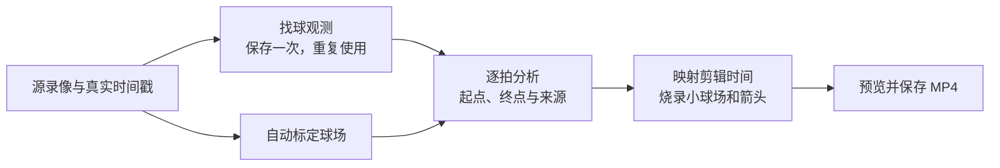

# 成片中的二维球路

在剪辑成片右上角显示带场地线的小球场，以当前拍的完整箭头展示击球起点到终点。首版已按用户确认合入 develop，面向固定机位的比赛高视角单打录像；目前继续演进，高远球估计准确性不足，其他拍摄场景待扩展。

## 如何组成

算法输出、调用和适用条件由[球路模块](../../../modules/trajectory/README.md)维护；产品开关、展示与导出由[自动剪辑需求](../../../apps/video-clipper/requirements.md)维护。

## 首版范围

- 先自动标定，不增加人工标定步骤；现有测试视频上的标定必须实际跑通。
- 以逐拍起点和预计落点为核心，允许部分帧没有球点；非末拍箭头必须完全位于场内并跨过球网，最后一次真实击球豁免。违规起点先用击球者同侧人物位置修正，缺少精确记录时只在前后同侧人物记录均距击球不超过 220 毫秒时插值；违规终点依次尝试下一次真实击球起点和该击球者的人物位置。修正后仍违规则隐藏箭头，不裁边、不捏造坐标。
- 被接回的球也尝试预计落点；不可靠时可使用下一次击球位置或实际落地点。结果保留终点来源，图上统一称为球路。
- 高视角默认开启、上传页可关闭；固定右上角，每拍替换箭头，不累积历史。
- 输出与画面只展示球场平面坐标；不包含球速、三维展示、其他视角或公开发行包。

## 验证与进展

两份真实样本已用保存的球点和人物轨迹完成离线修正与成片烧录；本轮追加人物位置推算起点。用户已确认首版合入 develop。当前没有最终独立视觉验收结论，不代表落点精度达标。算法输出、当前产物及已知边界见[球路模块报告](../../../modules/trajectory/reports/trajectory-overlay-round3.md)与[产品记录](../../../apps/video-clipper/reports/trajectory-overlay-v1-product.md)。

本轮验收检查真实模型与成片能否跑通，以及场地线、起点所对应选手、球路大致方向与区域、箭头切换、漏拍和跳变。测试同时覆盖关闭开关、剪辑边界、原音画偏移及可变帧率。

首版不预设量化落点精度；工程检查或图像拟合误差不能证明预计落点准确。正式实验与失败案例随所属模块、应用报告维护，逐轮执行记录留在任务材料中。

## 研究与验证

后续研究可比较线性回归、稳健拟合与空间约束，并参考 [MonoTrack](https://arxiv.org/abs/2204.01899)。适用条件、误差、漏检容忍度及被接回球预计落点的验证方式由实验明确。播放同步沿用剪辑时间轴，不依赖实时处理任务。

## 后续优化

具体优化方向与待确认事项见[二维球路优化](optimization.md)。
