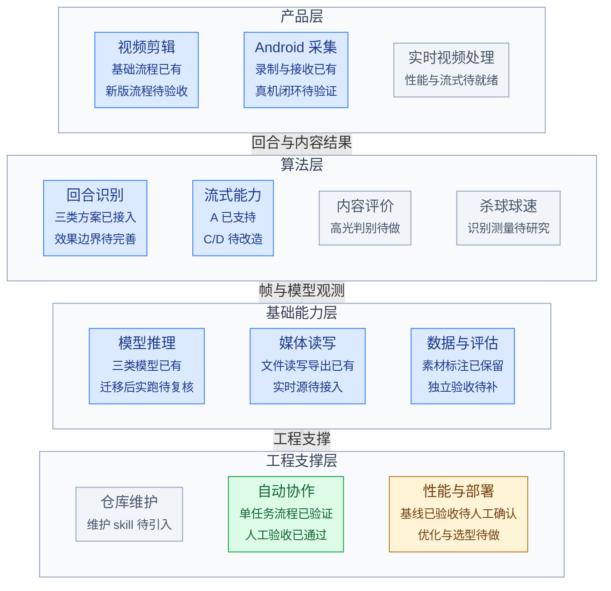
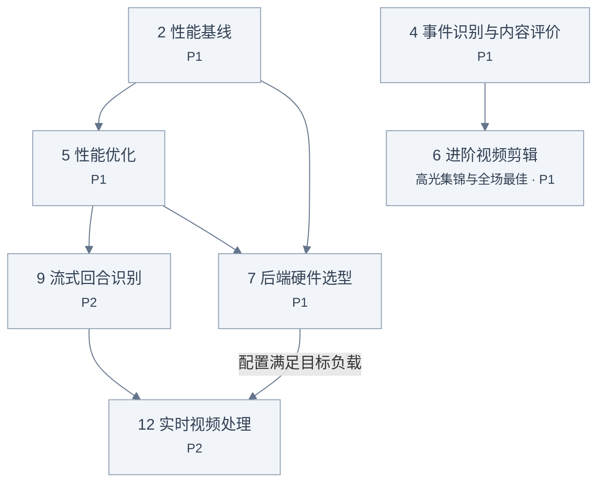

# 项目路线图

本文档维护项目任务、优先级、依赖、项目状态。
各需求的具体范围、技术方案、实施计划和验收门槛在需求文档中说明。

- 项目产品演进方向
  - 视频流处理
  - 视频剪辑生成
- 算法提供回合、内容与球速能力
- 工程流程支持智能体长期协作和独立验收。

## 项目进度总览

框图展示能力的组合与当前进度；说明了已有能力和主要缺口。

🟩 绿色：已完成　🟦 蓝色：演进中　🟨 黄色：原型开发中　⬜ 灰色：未开始　🟥 红色：阻塞

模块入口：[视频剪辑](../../apps/video-clipper/README.md) · [Android 采集](../../apps/android-capture/README.md) · [回合识别](../../modules/rally/README.md) · [模型推理](../../modules/models/README.md) · [媒体读写](../../modules/media/README.md) · [数据与评估](../../datasets/README.md)。详细进展与证据由各目录维护。

## 进行中的任务

采用单任务持续开发 skill 时，任务分支可在独立验收后标为“已完成，待人工确认”；develop 保持“进行中”，直到人工确认交付并集成后再标为“已完成”。

| 任务 | 负责人 + 分支 | 当前进展 |
| --- | --- | --- |
| 性能基线 | benb365 + codex/performance-baseline（本任务分支） | 已完成，待人工确认：六正式实测、三短剖析、十份输出核对及独立验收完成，[性能报告](../../apps/video-clipper/reports/performance-baseline.md)；尚未集成 |
| Windows 后端适配 | cjfranklin1 + [codex/windows-runtime](https://github.com/benb365/smash-suite/tree/codex/windows-runtime) | 已开始推进，适配与验证结果待同步 |

认领任务时在此登记**任务、负责人或可定位的会话、当前进展**，并同步任务表状态；结束后移除此处记录。待领取工作统一查看任务表。

## 需求依赖

箭头表示前置关系，只展示有关联的需求；无关任务不必等待整条链完成。

先建立当前版本的性能基线并优化，再推进流式与实时处理；硬件选型依据实测与目标负载。效果验证贯穿各项改进，不要求先解决所有已知问题才能验证产品。

文件剪辑可以复用已有回合区间和导出能力，不依赖流式改造；高光与全场最佳需要内容判别，杀球球速是可选信息，不是强制前置。

## 项目任务与优先级

### 优先级

- P0：重要且紧急
- P1：重要但不紧急
- P2：当前阶段不重要且不紧急，排后推进
- P3：已记录，近期不安排

任务编号用于引用任务，不代表优先级或执行顺序。“直接依赖”列只列出直接前置任务的编号，不包含间接依赖；`—` 表示没有前置任务。领取前须确认所列任务均已完成，且当前任务未被他人认领。

任务名称以斜体标注时，表示所需前置结果尚不可用，当前不能开始开发；前置结果可用后移除斜体。

| 编号 | 任务 | 目标与范围 | 优先级 | 直接依赖 | 状态 |
| --- | --- | --- | --- | --- | --- |
| 1 | 自动协作 workflow | 建立已确认单任务的持续开发流程，经过独立功能、代码和文档验收；人工确认后再集成 develop | P0 | — | 已完成 |
| 2 | 性能基线 | 固定当前版本和代表性输入，测量完整耗时、处理速度及内存等资源开销 | P1 | — | 已完成，待人工确认 |
| 3 | 回合效果与场景适应 | 改善漏回合、边界缺失、间歇残留与主场选人，使用独立来源验证效果与适用范围 | P1 | — | 待办 |
| 4 | 事件识别与内容评价 | 提供高光、全场最佳等剪辑所需的内容判别能力，含义与标准在需求中明确 | P1 | — | 待办 |
| 5 | *性能优化* | 根据基线降低处理成本，验证速度收益及识别效果变化，为后续流式处理提供基础 | P1 | 2 | 待办 |
| 6 | *进阶视频剪辑* | 支持高光集锦、全场最佳等内容筛选与成片生成，具体范围与验收另行规划 | P1 | 4 | 待办 |
| 7 | *后端硬件选型* | 依据实测、目标负载及优化结果比较硬件，确认适用的后端配置 | P1 | 2、5 | 待办 |
| 8 | 仓库维护 skill | 引入清理与重构 harness（辅助检查、清理和验证的机制），定期维护代码、架构和文档，保持简洁规范 | P2 | — | 待办 |
| 9 | *流式回合识别* | A/C/D 持续接收视频并输出回合；C/D 允许有限延迟，使用后续到达的画面确认结果 | P2 | 5 | 待办 |
| 10 | 杀球球速侦测 | 识别杀球并输出球速，确认可测条件、准确性与适用范围 | P2 | — | 待办 |
| 11 | Windows 后端适配 | LTE 工作：适配并验证 Windows 下的后端运行 | P2 | — | 进行中 |
| 12 | *实时视频处理* | 连通真实拍摄、传输、持续分析与结果访问，含 Android 真机采集、上传可靠性和整体延迟验证 | P2 | 7、9 | 待办 |
| 13 | 数据管理 | 管理素材、标注、分析结果和成片的组织、留存与清理，覆盖研发材料与产品数据 | P3 | — | 待办 |
| 14 | 发行与商用 | 处理产品分发、签名公证、授权审查、商用交付与平台支持 | P3 | — | 待办 |

必要的素材、标注、测试和评估随所属需求推进，不因数据管理排后而推迟。独立验收 agent 与开发 agent 分工，不能替代算法验收所需的独立来源数据。
