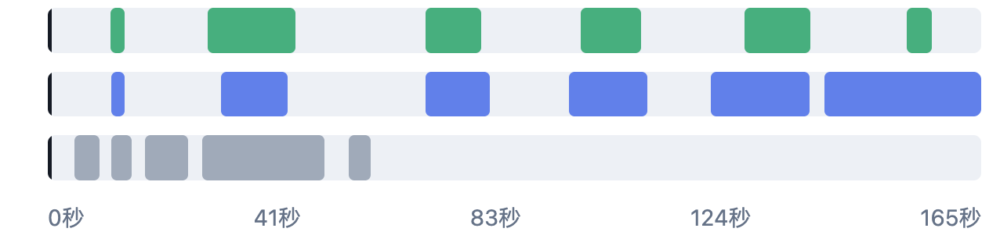

# 视频结果展示约定

需要人工查看视频标注、回合分割结果或算法前后差异时，默认采用**视频播放器 + 同一时间横轴上的多行色块**。
让人能直接看到“哪段保留、哪段删除、哪里与人工判断不同”，并点击对应位置观看原视频。
文字说明和结果表作为补充，与视频和时间轴关联。

这项约定适用于实验检查页，以及后续产品中需要查看视频时间区间的界面。
它规定展示与交互方式，具体开发顺序仍由路线图决定。

## 用户确认的形式

示意图中的具体时长和片段数量仅为例子。各行使用同一个起点、终点和横向比例，便于直接比较。

| 行 | 默认颜色 | 含义 |
| --- | --- | --- |
| 人工确认的回合 | 绿色 | 已经人工确认应当保留的时间区间 |
| 本次算法保留 | 蓝色 | 当前展示的算法实际输出 |
| 优化前保留 | 灰色 | 用于对照的旧结果；有旧结果时展示 |

每行必须有文字名称和颜色说明，不能只靠颜色区分。没有人工标注或旧结果时，明确说明并省略对应行，不补造区间。
额外比较其他结果时增加有名称的行，同一页面内保持颜色含义一致。

## 时间轴与视频联动

- 视频播放器和所有色块行放在同一查看区域，时间刻度对齐。横轴按实际时间等比例绘制，色块宽度反映真实持续时长。
- 视频播放时，所有行用同一条当前时间指示线同步移动，并显示当前时间。
- 拖动视频进度条，色块行的指示线同步更新；点击时间横轴或色块，视频跳到对应时间。
- 暂停、调速和跳转后仍保持一致。切换视频时同步更新片长、刻度、色块和当前时间，清除上一段的播放范围。
- 原视频、预览视频与标注存在起点偏移时，记录并统一换算。使用实际帧时间，不用估计帧率猜测；不为对齐显示而修改人工标注。

## 方便人工检查

- 默认连续播放完整原视频，让人能查看被算法删除的画面。
- 可提供“按程序结果播放，跳过删除部分”选项，明确这是模拟剪辑；切回完整播放后可继续检查缺失内容。
- 对具体回合提供“看开头”“看结尾”“看整回合”，跳转时保留前后短暂上下文，便于判断有没有切早或切晚。
- 额外保留但没有覆盖人工回合的片段单独列出，并可直接播放；裁掉正常对打的位置也应能直接跳转。
- 表格、问题列表和色块必须引用同一份标注与算法结果。页面展示已保存的实际输出，不在前端另算一套分割结果。
- 显示易反馈的视频名称、回合序号和时间。结果用“少留多少正常对打”“多留多少间歇”等通俗说法；实验编号或新名词出现时解释含义。
- 播放或点击本身不代表人工确认；审核决定与查看行为分开记录。

## 开发与检查

优先复用已有播放器、结果数据和联动逻辑。临时检查页可以保持简单，不必为此引入新的前端框架或重复编码原视频。
临时页面和生成的数据继续遵守仓库运行产物的存放约定；本约定及上面的参考图长期保留在仓库中。

交付前实际打开页面，至少检查：

1. 视频可以播放，点击色块、点击时间轴和拖动视频进度条都能互相联动。
2. 播放、暂停、调速及切换视频后，时间指示线与实际画面一致；特别核对一个回合开头和结尾的时间映射。
3. 人工区间、算法区间与原始记录一致；表格中的跳转能到达同一视频位置。
4. 可以在完整原视频中看到少留的对打和多留的间歇，不只展示汇总数字或截取后的好片段。
