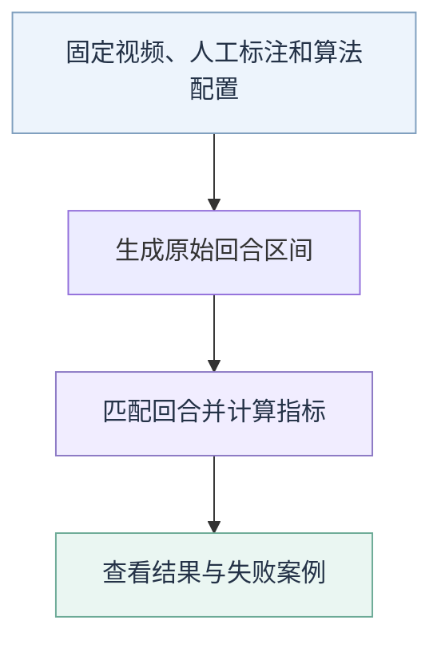

# 回合识别评估

评估同时回答三件事：有没有漏掉对打、有没有多留间歇、起止时间是否合适。比较候选时，使用同一批视频、标注和评分规则。

## 评估流程

评分不使用应用补时后的区间。执行入口和命令见[模块的效果评估](README.md#效果评估)。

## 回合算法测试视频

| 项目 | 要求 |
| --- | --- |
| 场景 | 固定机位单打，按官方高视角、非官方高视角、场边低视角、个人斜侧方分别评估；当前启用类别见[路线图](../../docs/plan/roadmap.md) |
| 时长 | 每个启用类别的整个素材池累计至少 10 分钟；同源重复或重叠内容不重复计入 |
| 内容 | 先人工确认来源，再截取保留对打和间歇的连续片段；不限定片数、单片长度或完整一局 |
| 数据划分 | 调试与独立验收按来源和相关拍摄会话隔离；同一录像的不同片段不能分作调参和独立验收 |
| 辅助信息 | 多球场可人工指定主场，各候选使用相同信息并记录依赖 |

10 分钟目标不分别施加给调试集和验收集，也不固定两者的数量配比。已反复看过或用于调参的素材只能用于诊断，不能改名为独立验收集。

素材清单、标注字段与种子输入见[数据规范](../../datasets/requirements.md)。只用人工已审核的目标回合（`verified`）正式计分；旧标注仍需核对是否符合当前[边界定义](requirements.md#回合边界)。部分标注之外的时间不能直接当作无回合负例。

## 可排除的事件

还球或已确认不纳入目标的短回合，需要人工记录类别、时间、排除原因和审核状态。待审事件不触发排除。

**只有预测完整落在同一个已确认排除区间内，且不与任何目标回合发生正时长重叠时，才忽略整条预测。** 跨出排除区间的预测照常计分，不裁短或拆分。

报告保留排除事件、被忽略的预测及对应关系、原预测数和计分预测数。算法自行删掉某片段，不会改变人工标注或全量计分分母。

## 主要指标

### 起止边界

只允许向回合外侧多保留最多 1.5 秒：

| 指标 | 达标范围 |
| --- | --- |
| 起点达标 | 比人工起点提前 0–1.5 秒，晚开始不达标 |
| 终点达标 | 比人工终点延后 0–1.5 秒，早结束不达标 |
| 双边达标 | 同一个匹配预测同时满足起点和终点要求 |

报告三项的数量及占全部目标回合的比例，未匹配目标也计入分母。边界允许范围包含端点，不另加帧级容忍；没有目标时比例为 `null`。

### 回合错误与时间保留

| 指标 | 含义 |
| --- | --- |
| 漏检 | 人工回合没有任何正时长重叠预测 |
| 误报 | 计分预测没有任何正时长重叠目标回合 |
| 误切 | 一个人工回合被多条预测切开 |
| 误合并 | 一条预测覆盖多个人工回合 |
| 对打时间保留 | 预测覆盖的目标时长 ÷ 目标总时长 |
| 非目标时间残留 | 保留的非目标时长及其占可计分非目标总时长的比例 |

时间按区间并集计算，重叠预测只计一次；非目标时间扣除已确认排除区间，目标时间优先。未单独确认负例范围时，非目标残留只作暂定诊断。

允许舍弃的超短回合另按人工时长分组报告数量、时长、保留程度、整段漏检及边界达标；候选与参照使用相同分界，全量结果继续保留。

### 处理成本

| 指标 | 口径 |
| --- | --- |
| 输出延迟 | 确认输出时刻减去回合结束时刻，逐回合记录并汇总 |
| 实时处理倍率 | 实际消费的输入源时长 ÷ 处理墙钟时长；1.0 表示实时 |

保存观测回放与真实模型运行分别计时。离线方案可将输出时刻记为文件末尾，但该值不参与实时延迟比较。

精确计算规则与结果字段

当前评估器为 [rally_eval.py](evaluation/rally_eval.py)，版本 `rally-iou-v3`。

**区间匹配**

- 先保留所有正时长重叠关系；边界接触不算重叠。
- 按时间交并比（两个区间交集时长除以并集时长）总和最大，做允许不匹配的全局一对一分配；不使用贪心匹配，不先合并人工区间。
- 一对一配对用于边界评分；原始重叠关系用于漏检、误报、误切和误合并。未匹配不等于漏检或误报。
- 误切为每个人工回合的 `max(0, 重叠预测数 - 1)` 之和；误合并为每条预测的 `max(0, 重叠目标数 - 1)` 之和。

**边界计算**（以下单位为毫秒）

| 字段 | 计算 |
| --- | --- |
| 起点允许范围 | `[truth.start_ms - 1500, truth.start_ms]` |
| 终点允许范围 | `[truth.end_ms, truth.end_ms + 1500]` |
| 起点超限误差 | `max(0, pred.start_ms - truth.start_ms, truth.start_ms - 1500 - pred.start_ms)` |
| 终点超限误差 | `max(0, truth.end_ms - pred.end_ms, pred.end_ms - truth.end_ms - 1500)` |

例如：起点提前 2 秒，超限 0.5 秒；晚 0.04 秒，超限 0.04 秒。终点延后 1 秒达标，提前 1 秒不达标。

**统计与留存**

- 人工代表值取审核起点范围左端、终点范围右端，不裁剪、扩张真值或把范围宽度视为零。
- 保存有方向的原始偏移 `pred - truth`、达标标识、超限时长与未达标案例；单向容忍不改变配对、时间覆盖，也不自动补时。
- 起点、终点超限统计分别只包含已匹配且该边界不达标的回合，报告数量、P50、P95、max；mean 仅供结构化诊断，不与旧绝对误差均值直接比较。
- 输出延迟保存所有计分预测的输出时刻，报告逐条值及 mean、P50、P95、max。空统计为 `null`；P50/P95 按排序后位置 `(n - 1) * p` 线性插值。
- 保留所有预测、已审核目标、未匹配标识、被排除的未审核标注标识及匹配前的重叠关系。时间指标分母为零时比例为 `null`。

## 结果与验收

| 需要保留 | 用途 |
| --- | --- |
| 算法、配置、视频、标注及评估器版本 | 重复计算同一结果 |
| 逐回合结果与失败位置 | 同时检查少留对打和多留间歇 |
| 数据用途与人工审核范围 | 区分调试结果、用户剪辑取舍及独立来源验收 |

数值通过门槛由实际结果讨论确认，不预先补造。用户接受某批剪辑不自动代表边界评分全合格、跨来源有效或速度达标。报告与配套结果见[实验目录](experiments/README.md#实验报告)。
