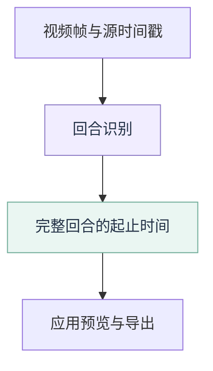

# 回合识别需求

从羽毛球录像中找出每个对打回合的起止时间。模块只输出时间区间，视频预览、补时和成片导出由应用处理。

## 输入与输出

帧、模型观测和区间字段见[模块接口](README.md#输入输出与职责)。区间使用原录像时间轴；应用的片头片尾补时不改变识别结果。

## 处理方式

| 方式 | 可使用的信息 | 输出要求 |
| --- | --- | --- |
| 流式处理 | 当前帧和历史帧 | 确认回合结束后输出一次，可回填开始时间；不修订或撤回已输出区间 |
| 文件分析 | 允许使用前后文 | 保留完整区间和源时间戳，不把文件末尾的记账时刻当作实时延迟 |

A 的逐帧入口遵守流式要求；C/D 使用文件分析。流式输入的帧标识和时间戳必须严格递增，乱序、重复或回退应报错。本地视频逐帧回放与真实帧生产者使用相同契约。

流式区间满足 `start_ms <= end_ms <= emitted_at_ms`。等待结束确认只影响输出时刻，不延长回合本身；文件结束也不能代替回合结束证据。

## 回合边界

| 边界 | 定义 | 不作为边界依据的情况 |
| --- | --- | --- |
| 开始 | 发球时球拍击中球 | 发球准备、走到位置 |
| 结束 | 球落地，或其他能明确确认结束的事件 | 触网后仍在飞行、球员停步、运动暂时减小 |
| 不确定 | 看不清起止事件 | 保留原帧和待审记录，不猜测时间点 |

人工只能确认一个时间范围时，保留该范围；经审核后，开始取左端、结束取右端作为保守代表值。代表值不等于精确触球或落地时刻。标注与评分规则见[评估规范](evaluation.md)。

## 还球与短回合

- 还球不属于正式回合。接发失败及正常超短回合允许按已确认的取舍保留或舍弃，主要目标是保住长回合和持续对抗。
- 具体秒数属于场景方案与实验参数；3 秒、5 秒不能直接变成通用产品限制。
- 模型漏追球造成的短碎片，不能改称原本很短的回合。算法过滤结果也不能自动改成人工排除事件。

判断线索与容易混淆的情况

- 单向飞行、片段短、轨迹零碎都只是线索。先检查轨迹是否完整可信，再判断是否存在回击。
- 没追到返球不等于没有返球；高球自然升降不等于对手回击。不能只数画面方向变化或只按持续时间删除。
- 区分局部触球变化与持续返回的飞行；缺失处不补造坐标，不预设固定击球位置，也不统一要求 95% 可信坐标或开打前的静止球。
- 对无法确定的短片段，可对照保留与试删的结果，分别报告少留的间歇和误删的正常回合。已连接的高球及有持续返回证据的片段优先保留。

## 视频使用条件与待验证的限制

当前范围是固定机位单打。以下条件需通过试验确认后，才能写成对使用者的硬性要求。

| 条件 | 待回答的问题 |
| --- | --- |
| 球场完整入画 | 必须看到完整球场，还是只需关键区域可见？ |
| 球的飞行轨迹入画 | 顶部短暂出画能否可靠连接？ |
| 相邻球场同时活动 | 如何确认主场归属，是否需要用户指定主球场？ |
| 清晰度与遮挡 | 缺失到什么程度会影响回击、还球和落地判断？ |

尚未确认分辨率、帧率或遮挡时长门槛。实验需记录具体样片、出错位置、尝试与结果，不能先删掉困难样本再宣称效果达标。

## 范围边界

本模块不负责成片生成、击球动作分类、球速、摄像头接入或网络传输。模型和规则的选择应有对照证据；已有方案及调用方式见[模块说明](README.md)，后续工作见[路线图](../../docs/plan/roadmap.md)。
