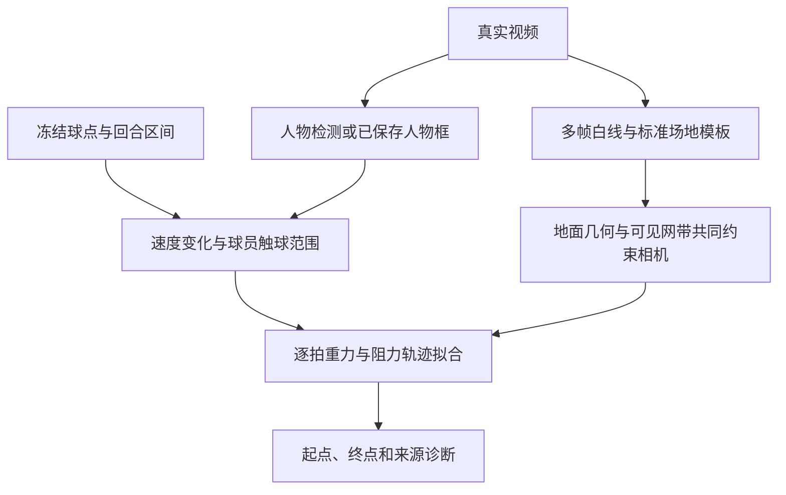

# 二维球路分析

从固定高机位单打视频提取每拍在球场平面上的起点和终点，供应用绘制同步箭头。模块独立于剪辑产品；首版已获用户确认合入并继续演进，没有最终独立视觉验收结论，不承诺落点精度。

## 运行入口

先按[项目首页](../../README.md#开发环境)准备环境。以下命令从仓库根目录执行，权重目录须已有 `ball_track.pt` 与 `yolo11n.pt`。

首次采集球点及回合区间：

```sh
.venv/bin/python -m modules.trajectory capture \
  --video input.mp4 --output modules/trajectory/.runtime/example \
  --weights-dir /path/to/models
```

采集前按[媒体预检](../media/README.md#输入预检)完整解码真实视频。采集生成 `ball-observations.jsonl`、同名 `.meta.json` 和 `rallies.json`；源文件、权重哈希和行数一致且采集完成时复用。失败时保留 `complete=false`，不能作为完整缓存使用。重算同时核对实际行数、末时间与清单一致；保留旧完整清单的截断文件也会被拒绝。

修改标定或逐拍算法后，复用球点离线重算：

```sh
.venv/bin/python -m modules.trajectory analyze \
  --video input.mp4 \
  --observations modules/trajectory/.runtime/example/ball-observations.jsonl \
  --rallies modules/trajectory/.runtime/example/rallies.json \
  --output modules/trajectory/.runtime/example --weights-dir /path/to/models
```

`analyze` 不运行 TrackNet。源文件与 YOLO 权重哈希匹配时复用输出目录中的人物框；每次重新标定，避免复用旧相机方法。输出目录由调用方管理。

## 输入与输出

```python
from modules.trajectory import ObservationLog, analyze

with ObservationLog(point_path, source=source, info=info,
                    weight=weights['ball_track.pt']) as sink:
    predictions, details = recognize(..., observation_sink=sink)
paths = analyze(source, info, predictions, point_path, weights, directory, progress)
```

`ObservationLog(frame, point)` 接收推理用的 1920×1080 `TimestampedFrame` 和 `ShuttlePoint`；源首帧时间归零，毫秒。低于 0.6 的峰只保留置信分数，坐标写为空；帧号与时间必须严格递增。开启记录不改变回合判断。

`analyze` 的 `predictions` 是原始回合区间，`info` 来自媒体 `probe`，`weights` 含已有球和人物模型路径。结果同时返回并保存为 `shot-paths.json`：

| 字段 | 含义 |
| --- | --- |
| `schema_version` | 当前为 1 |
| `coordinate_system` | 米；单打宽 5.18、长 13.4；x 从左到右，y 从远端到底近端 |
| `court.image_from_court` | 球场地面到 1920×1080 参考画面的投影矩阵 |
| `court.projection` | 有真实网带高度支持时的三维相机；可能为空 |
| `shots` | 回合/拍编号、源起止毫秒、`start_xy`、`end_xy`、`end_kind` 及诊断 |
| `diagnostics` | 球点、人物、每回合触球数、终点来源和场内约束替换/隐藏数量 |

原点是远端单打左底角，球网 y=6.7；双打边线 x=-0.46/5.64。分析结果在保存前应用输出约束：每回合非末拍箭头的起终点都须在含边线的单打场内 `x=[0,5.18]`、`y=[0,13.4]`，且分处球网两侧。球网线上的点不算位于某一侧。每回合最后一次有起点的真实击球豁免；未知占位段不会改变末拍，即使末拍自身未解析，也不会豁免前一拍。单拍回合自然豁免。

已解析的非末拍若起点越界、落在网线上或与已知击球方不在同一侧，先用同侧人物在击球时刻的场上位置修正；没有精确记录时，仅当前后同侧记录都距击球时刻不超过 220 毫秒才插值，不外推。修正仍不在场内或不符击球方时隐藏箭头。起点合规后，若终点越界或没有跨网，先尝试下一次真实击球的起点，再尝试该击球者的人物位置；未知占位段会被跳过，末拍坐标本身不变。替代仍不合规则将该段置为 `unresolved` 并清空终点。原起终点、来源、估计方法、输入时间及拒绝原因保存在 `diagnostics.court_constraint` 中，不把坐标夹到边线或捏造到对侧。原本未解析的区间不会恢复箭头。该限制只约束输出展示，不证明物理拟合正确，也不改变击球识别。

输出不是线上实时因果结果：分析可使用下一次击球与整拍飞行。

## 分析流程



球场使用前段多帧的时间中值图，匹配标准单双打白线。相机明确假设方形像素、主点在图像中心，以地面几何和真实网带 1.55 米高度共同拟合；不把网柱顶部的横坐标硬设成底部横坐标。相机不一致时拒绝高度预测。

击球候选来自观测速度变化及人物触球范围。短漏点可使用观测转折；长漏点的外推不连续不能单独作为击球证据。缺口两侧可独立拟合且接近真实人物触球范围时恢复隐藏接触，并记录可能接触的时间区间；重复停滞的球点使用连续分段拟合识别恢复运动。直接运动候选优先于缺口弧线推断；局部顶点与两侧运动方向一致时优先于孤立抖动。候选簇限制总跨度，避免连续串联吞拍。击球方只由实际触球位置和人物范围决定，不按交替关系改写。前一拍漏检不能抹去后续独立观测支持的同侧触球，对手具体时刻缺失时另列未知区间。拟合本拍时排除下一击球帧，避免混入回球后的数据。起点优先使用通过拟合的接触位置投影；失败时用球员脚点代理，并记录 `start_source`。

终点按证据选择：

1. 最后一拍有接近后明显减速、短暂低速且没有恢复长距离飞行的可见尾段时，使用 `detected_landing`。滑动与小弹跳允许保留，仍属于基于图像的估计。
2. 其余情况拟合重力与平方速度阻力，外推到高度为零；被接回时用下一击球者位置作软约束，解除单目深度歧义。通过物理、接触位置和重投影检查后标记 `predicted_landing`。
3. 拟合失败但有下一次击球时使用 `next_hit`，终点是下一球员脚点代理。
4. 无可信飞行、下一击球或落地证据时为 `unresolved`，保存失败原因。

长时间无观测且可能漏掉对手触球时，已知飞行只输出到最后支持帧之后，随后另列 `start_xy/end_xy=None` 的 `unresolved` 段，清除旧箭头；不按固定拍频补造触球时刻。因此 `shots` 的区间段数可能大于触球事件数，实际事件数见 `diagnostics.rallies[].hits`。`hit_method` 与 `contact_interval_ms` 标明观测、缺口推断及时间不确定性。

`predicted_landing` 是假设没有被接回时的预计落点，与下一拍接触位置不同。低重投影误差只说明像素拟合，不证明落点真值。

## 检查结果

输出目录同时保留 `court.json`、`court-calibration.jpg`（红色地面线、黄色网带高度参考）、`court-line-mask.png`、`people-observations.json` 和 `player-tracks.json`。先检查叠线与人物，再检查逐拍起点、方向、漏拍和终点来源。

展示已保存回合或逐拍区间时使用仓库 [review-video-results](../../.agents/skills/review-video-results/SKILL.md) 查看器，不创建另一套网页。真实样本与已知缺口见[当前返工报告](reports/trajectory-overlay-round3.md)与[首轮记录](reports/trajectory-overlay-v1.md)。

## 测试与边界

```sh
.venv/bin/python -m pytest modules/trajectory/tests modules/rally/tests/test_tracknet_rally.py
```

测试包含相机数学、真实缓存的漏点与落地回归、终点优先级、下一击球帧隔离、场内/跨网输出约束及末拍豁免。合成相机仅验证几何，不作为真实视频效果证据。

当前仅针对两份固定高视角单打样本调试。场地候选有高机位画幅位置约束；镜头移动、广角畸变、场边视角、双打多人、人物重叠、出画和长漏点尚不稳健。击球时间与落地是算法推断，不能当作人工标注或精度验收。
