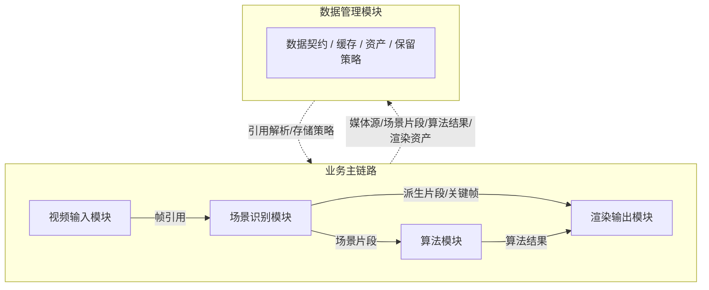
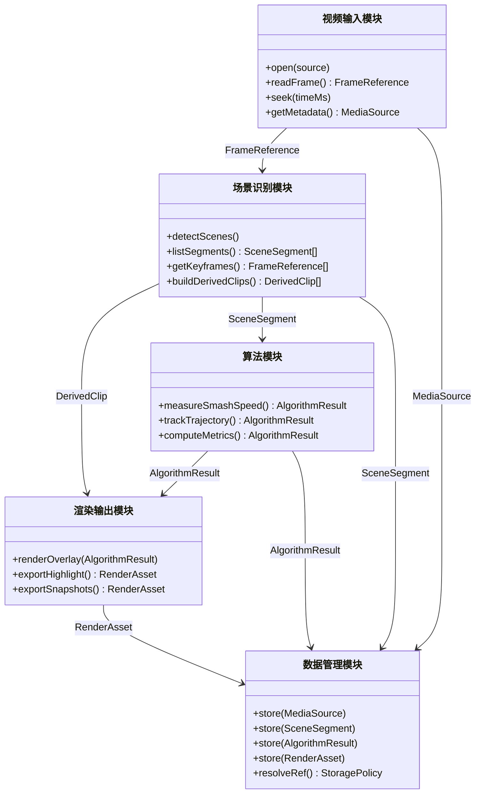

# 架构设计

## 概述

Smash Suite 的长期目标不是单一测速工具，而是一个集成的羽毛球视频套件。当前最小可行版本（MVP）只聚焦于杀球测速，用于尽快验证本地视频处理、视觉分析和实时展示链路；长期版本则应逐步扩展为面向训练、复盘、内容生产和数据沉淀的一体化系统。

整体架构围绕五个核心模块构建：视频输入模块、场景识别模块、算法模块、渲染输出模块、数据管理模块。各模块之间通过稳定的数据契约协作，避免把当前测速实现与未来更复杂的视频处理能力耦合在一起。

## 规划原则

- 保持本地优先，优先在本机完成视频处理、分析和导出。
- 模块之间优先传递引用、索引和结构化结果，减少大体积媒体复制。
- 当前 MVP 的实现需要尽量向长期架构对齐，避免形成一次性 Demo。
- 先把输入标准化和场景裁剪做好，再在此基础上叠加更多算法和渲染能力。
- 数据管理从第一阶段就要考虑带宽、存储和后续可追溯性。

## 长期架构

上图描述了推荐的数据主链路：视频输入模块先负责统一输入，场景识别模块负责识别和裁剪有效比赛内容，算法模块只处理有效场景，渲染输出模块组合场景与算法结果生成面向用户的媒体输出，数据管理模块横向贯穿全链路。

## 模块详述

### 1. 视频输入模块

职责：

- 接入不同来源的视频数据，并向上层提供统一输入抽象。
- 屏蔽不同设备、封装格式、编码格式和采集方式的差异。
- 为后续模块提供稳定的时间戳、帧访问能力和媒体元数据。

长期接入方向：

- 通用视频流数据。
- 各类视频文件。
- 本地摄像头。
- 设备直出的 YUV 视频流。
- 后续可扩展的 RTSP、USB 采集卡或外设流。

设计要求：

- 上层不依赖具体设备和容器格式。
- 输入模块负责将外部视频源标准化为统一的帧流、时间轴和媒体描述信息。
- 具备按需解码、顺序读取、局部回放和未来零拷贝优化的空间。

### 2. 场景识别模块

职责：

- 从视频输入模块获取视频数据，识别有业务意义的比赛场景。
- 识别多个场景，例如回合进行期间、杀球、长多拍等。
- 裁剪无效时间，形成适合下游算法和用户消费的片段化数据。

核心目标：

- 重点不是做泛化动作理解，而是服务于场景识别和无效数据裁剪。
- 尽量用轻量的时间段、关键帧和片段引用来表达结果，而不是过早生成大量新视频文件。
- 为算法模块和渲染输出模块提供统一的场景索引与关键帧访问接口。

对外能力：

- 关键帧查询接口。
- 裁剪了无效时间的对局视频片段接口。
- 杀球慢动作片段接口。
- 场景片段检索接口。

### 3. 算法模块

职责：

- 基于场景识别模块输出的有效片段进行数据处理和指标计算。
- 针对特定场景运行对应算法，例如根据视觉算法计算杀球速度。
- 随着项目演进，扩展为击球统计、落点分析、节奏分析等能力的承载层。

设计要求：

- 算法模块优先消费标准化场景片段，而不是直接消费整段原始视频。
- 算法结果需要具备可追溯性，能够回链到源片段、关键帧和置信度。
- 算法实现要允许 baseline 与模型算法并存，便于对比和替换。

### 4. 渲染输出模块

职责：

- 将算法模块和场景识别模块的输出编辑为面向用户的多媒体结果。
- 面向训练复盘、内容消费和分享，生成截图、短视频和高光内容。

典型输出：

- 高光时刻截图。
- 精彩对局视频。
- 杀球慢动作视频。
- 带速度读数、轨迹叠加和场景标签的可视化输出。

设计要求：

- 渲染输出不重复做识别和计算，而是复用场景结果与算法结果。
- 同时支持轻量预览和高质量导出两种模式。
- 优先复用已有片段引用和中间结果，减少重复编码和重复存储。

### 5. 数据管理模块

职责：

- 定义各模块之间的输入输出格式、元数据结构和生命周期。
- 管理原始数据、中间结果、派生资产和导出内容。
- 在保证可追溯性的前提下，最大化降低带宽和存储成本。

设计要求：

- 原始视频尽量只存一份。
- 模块间优先传递时间范围、帧范围、关键帧索引和资产引用。
- 慢动作、高光片段等派生内容按需生成，而不是默认全量落盘。
- 中间产物分层保存，便于后续清理、重算和版本演进。

## 数据契约

长期需要为各模块定义稳定的数据契约。建议优先落地以下对象：

- 媒体源（`MediaSource`）：输入源类型、容器、编码、分辨率、帧率、时间轴、设备信息。
- 帧引用（`FrameReference`）：帧号、时间戳、关键帧属性、所属媒体源引用。
- 场景片段（`SceneSegment`）：场景类别、起止时间、关键帧、置信度、源媒体引用。
- 派生片段（`DerivedClip`）：裁剪片段或慢动作片段的引用、编码信息、生成策略。
- 算法结果（`AlgorithmResult`）：指标值、来源场景、依赖帧范围、置信度、算法版本。
- 渲染资产（`RenderAsset`）：截图、带叠加的视频、预览图、分享素材等导出结果。
- 存储策略（`StoragePolicy`）：缓存、保留、清理、压缩和重算策略。

这些数据对象的重点不是一次性定死全部字段，而是先明确模块间应传递“引用和结构化结果”，尽量不在早期就把实现绑定到具体文件布局或某一类算法上。

## 模块交互图

上图说明了模块边界与各节点之间流转的数据契约对象，标注在箭头上的均为数据契约章节中定义的对象。数据管理模块统一接收各模块产出，不再反向驱动业务链路，避免双向耦合。实际实现可以是服务、任务节点、消息对象或文件约定，职责不应混淆。

## 当前进度

截至 2026-05-06，项目已经完成测速 MVP 的第一批基础设施，具备从输入、分析到可视化展示和结果导出的最小闭环。

### 已完成

- 后端已建立 FastAPI 服务、REST API 和 WebSocket 推送通道。
- 已支持两类基础输入源：本地视频文件路径和本地摄像头索引。
- 已实现球场四点标定与平面投影，能够把像素点映射到球场平面坐标。
- 已实现基于 OpenCV 传统视觉 baseline 的高速运动候选检测、轨迹点生成和速度估计。
- 已实现速度平滑、关键速度峰值事件生成，以及 JSON 和 CSV 导出。
- 前端已具备创建会话、保存标定、启动分析、实时接收轨迹和速度样本、展示当前速度与峰值速度的能力。
- 后端基础测试已覆盖标定逻辑与速度计算逻辑，当前测试通过。

### 已有实现对应到长期模块

- 视频输入模块：已具备本地视频文件和摄像头输入的最小实现，尚未抽象成统一多源输入层。
- 场景识别模块：目前只有最低限度的关键事件能力，尚未实现回合识别、长多拍识别和无效时间裁剪。
- 算法模块：已完成平面标定、运动检测、轨迹点和速度曲线的 MVP 实现。
- 渲染输出模块：已完成 Web UI 实时读数和曲线展示，尚未实现高光视频、慢动作或截图生产。
- 数据管理模块：已具备本地 session 目录、结果 JSON 和 CSV 导出，但尚未形成统一的数据契约和分层存储策略。

### 当前缺口

- 输入能力还没有覆盖通用流、YUV 原始流和更多外部设备。
- 场景识别尚未从“测速触发”升级到“完整对局片段理解与裁剪”。
- 算法层仍以单一测速链路为主，未形成多算法协同架构。
- 渲染输出还停留在实时 UI 展示阶段，缺少对外部可消费媒体资产的生产能力。
- 数据管理还没有定义统一的模块输入输出对象、缓存层次和清理策略。

## 阶段路线图

--TODO--